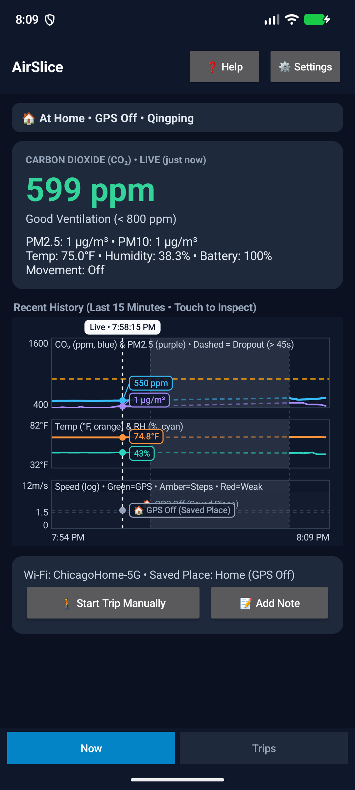
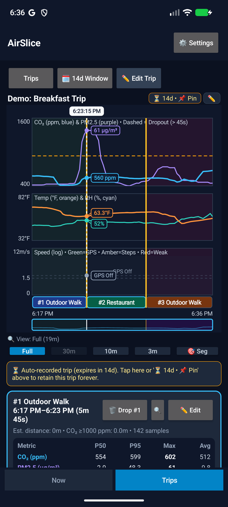
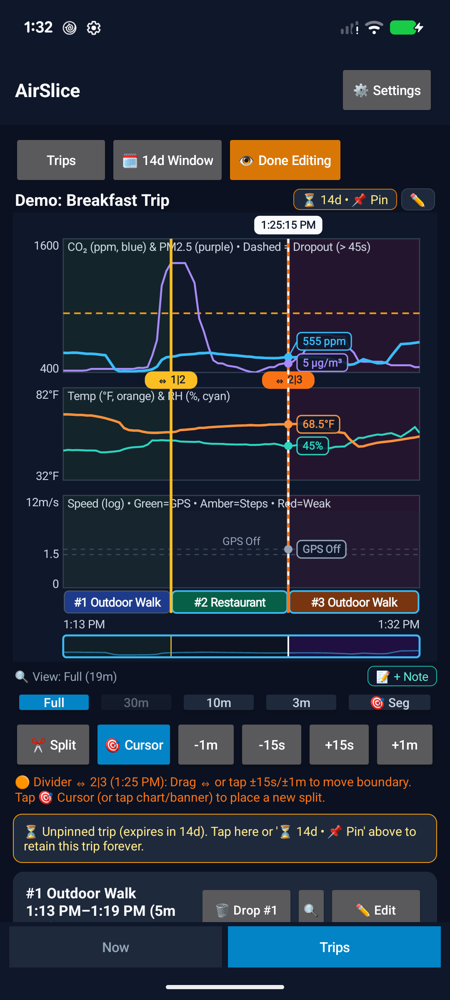
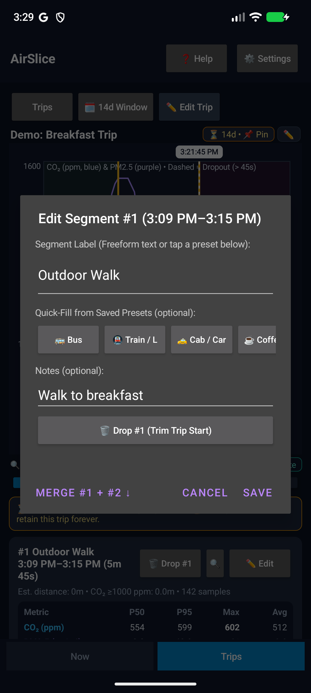
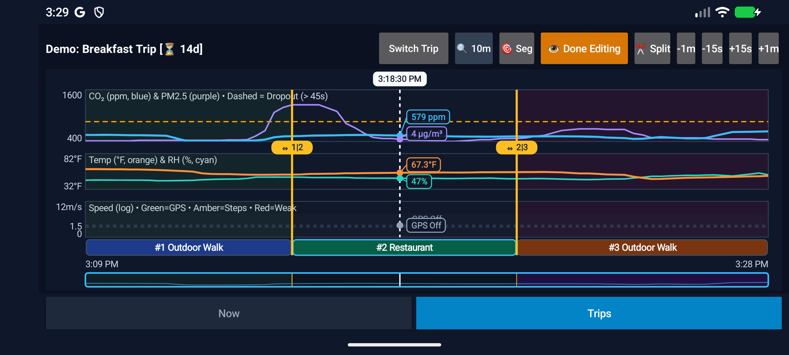
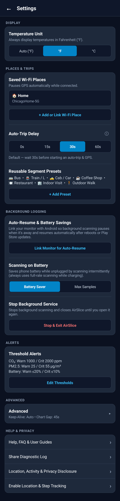

# AirSlice: Portable Air Log — Portable Qingping Air Monitor Lite (`CGDN1`) Companion

**`AirSlice: Portable Air Log`** (**`AirSlice`**) is an Android application (**Android 13+ / API 33+**) that turns a **Qingping Air Monitor Lite (`CGDN1`)** into a cloud-free, field-portable environmental recorder and retrospective trip slicer for **CO₂, PM2.5, PM10, Temperature, and Relative Humidity**.

| Live **Now** Dashboard | **Trips** — 3-Pane Synchronized Telemetry Timeline |
| :---: | :---: |
| [](docs/screenshots/now_dashboard.webp) | [](docs/screenshots/trips_view_mode.webp) |

---

## Why `AirSlice`? (Portable Bluetooth Recording vs. Stationary Wi-Fi)

The **Qingping Air Monitor Lite (`CGDN1`)** packs research-grade environmental sensors (Sensirion SCD40 CO₂ sensor, Plantower PMSA003I laser particulate sensor, and Sensirion SHT4x temperature/humidity sensor) into a compact, battery-backed enclosure. However, **its stock firmware and almost every existing third-party integration are built around a stationary, single-building use case**:

* **Stock Firmware & Other Clients Focus on Fixed-Location Wi-Fi + MQTT:**
  In its intended desktop setup, the `CGDN1` sits plugged into wall power on a 2.4 GHz Wi-Fi network and pushes telemetry to Qingping Cloud, Xiaomi Home, or a local **MQTT** broker. Consequently, almost all third-party clients and integrations (Home Assistant MQTT bridges, stationary BLE-to-MQTT hubs like ESPHome/OpenMQTTGateway, and web dashboards) assume the monitor lives on a shelf in one room with permanent Wi-Fi and mains power.
* **Why Stock Firmware Fails in Mobile Use:**
  As soon as you unplug the `CGDN1` and carry it out the door (into an elevator, onto a bus or train, or into an office, clinic, or restaurant), your home Wi-Fi and MQTT server are out of reach. Worse, out of the box (before initial setup), the monitor's Bluetooth is off—and if you hold the top touch-bar for ~7 seconds to wake Bluetooth, it enters **Wi-Fi setup mode** (replacing the normal CO₂ readout with a static Wi-Fi setup icon) and shuts Bluetooth back down after **1 to 30 minutes**. Normally, getting the monitor out of setup mode so it broadcasts continuously requires the proprietary Qingping+ or Xiaomi app, a user account, and a live 2.4 GHz Wi-Fi network.
* **How `AirSlice` Approaches Portable Field Recording:**
  1. **Direct Phone-to-Monitor Bluetooth Recording:** `AirSlice` receives live readings directly from your `CGDN1` over Bluetooth Low Energy on your Android phone—anywhere you carry it, with no Wi-Fi, cloud account, or MQTT broker required.
  2. **Automatic 5-Second Offline Setup:** If you hold the touch-bar for ~7 seconds on an unconfigured monitor, `AirSlice` completes setup offline over Bluetooth in ~5 seconds, restores the normal pixel-shifting CO₂ display, and unlocks continuous passive Bluetooth broadcasts—no Wi-Fi or vendor app required. Already-configured monitors stay untouched and passive.
  3. **Privacy-by-Default Location & Movement Correlation:** GPS and step sensing stay off out of the box until you configure a **Saved Wi-Fi Place** or start a trip manually, and pause automatically whenever you are at a Saved Place or away from the monitor. Raw coordinates and step counts are converted to speed and accuracy in memory and immediately discarded (see **[How Trips, Segments, and Splits Work](docs/trip_slicing_guide.md)** for **Auto-Trip Delay** and retention rules).
  4. **Battery-Friendly Auto-Resume & Stop Controls:** Optionally link your monitor via **Auto-Resume & Battery Savings** so `AirSlice` sleeps without a persistent notification while the monitor is away and wakes automatically when it returns or after reboots and updates, with a **Scanning on Battery** toggle (`Battery Saver` vs. `Max Samples`) and explicit **`Stop`** controls anytime (see **[FAQ](docs/FAQ.md#background-logging-battery-life--monitor-linking)**).
  5. **Retrospective Trip Slicer & XLSX Export/Import:** Instead of requiring live start/stop buttons, `AirSlice` records continuously into a rolling 14-day on-device buffer. Afterward, you can scrub a synchronized **3-Pane Graph Stack**, split and label segments, pin important trips permanently, and export or re-import self-contained `.xlsx` workbooks.

| Capability | Stock Qingping / MQTT Clients | `AirSlice` |
| :--- | :--- | :--- |
| **Primary Transport** | 2.4 GHz Wi-Fi + Cloud / Local MQTT broker | Direct Bluetooth Low Energy to Android phone |
| **Target Use Case** | Stationary room monitor on fixed Wi-Fi | Mobile excursions (transit, offices, clinics, elevators) + stationary monitoring |
| **Works Outside Home Wi-Fi?** | ❌ Loses connectivity as soon as you leave your AP | ✅ Records over Bluetooth anywhere with your phone |
| **Unconfigured Setup & Sleep Limits** | ❌ Bluetooth stays off or sleeps after 1–30m until set up via Qingping+ & Wi-Fi | ✅ **Automatic 5-second offline setup** + continuous passive recording (anti-burn-in OLED restored) |
| **Retrospective Trip Slicing** | ❌ Continuous unsegmented stream | ✅ Interactive 3-pane timeline slicer with named segments & notes |
| **Cloud / Account Dependency** | Typically requires Qingping/Xiaomi app or local server | **None** — 100% local on-device storage and direct XLSX export/import |

---

## Getting Started & Multi-Hour Field Trips

1. **First-Time Setup (or Waking Bluetooth on a Reset Monitor):**
   Turn your `CGDN1` on. If it is already set up, `AirSlice` starts recording passively right away. If it has never been set up (or `AirSlice` shows `📡 Monitor Out of Range`), hold the top capacitive touch-bar for **~7 seconds** until the static Wi-Fi icon appears on the screen:
   * `AirSlice` will automatically complete setup offline over Bluetooth in **~5 seconds** with no Wi-Fi network or vendor app required.
   * Within a few seconds, the monitor clears the static Wi-Fi icon back to its normal pixel-shifting CO₂ screen and streams continuous passive readings indefinitely.
2. **Multi-Hour Trips & External USB-C Power Bank Tip:**
   Because the `CGDN1` continuously powers an active CO₂ sensor, laser particulate fan, OLED screen, and wireless radio, its internal battery runs for roughly **1.5 to 3 hours**. For longer outings (such as clinic visits, travel days, or multi-hour fieldwork), **connect the monitor to a small external USB-C power bank** in your bag or pocket.
3. **Support for ESPHome / BTHome v2 Firmware:**
   `AirSlice` also decodes unencrypted **BTHome v2 (`0xFCD2`)** broadcasts passively out of the box—including **battery percentage** when provided by custom firmware such as [`nemethhh/esphome-qingping-cgdn1`](https://github.com/nemethhh/esphome-qingping-cgdn1). See **[How Your Monitor Works with `AirSlice`](docs/how_cgdn1_works.md)** for build flags and ESPHome YAML examples.
4. **Want to Know How It Works Under the Hood?**
   * Read **[How Your Monitor Works with `AirSlice`](docs/how_cgdn1_works.md)** for the monitor's setup vs. normal modes, Bluetooth timers, offline setup flow, and background/keep-alive settings.
   * Read **[Physical Hardware Observations (`CGDN1`)](docs/hardware_observations.md)** for byte-level protocol details, GATT UUIDs, and hardware traces.

---

## Key Features & Workflow

### 1. Live **"Now"** Dashboard (`15m` Recent History)
* Displays real-time **CO₂ (`ppm`)**, **PM2.5 / PM10 (`µg/m³`)**, **Temperature (`°F` / `°C`, locale-aware)**, **Relative Humidity (`%`)**, and **Battery (`%`, when supported)** with automatic stale-signal dimming when the monitor goes out of range.
* Includes a synchronized 15-minute 3-pane rolling chart for scrubbing recent readings (`↩ Live` snaps back) and **`📝 Add Note`** to drop timestamped bookmarks anytime.

### 2. Synchronized 3-Pane **Trip Slicer & History**
* **Three synchronized panes:** **Air Quality** (`CO₂` & `PM2.5`), **Thermal Comfort** (`Temp` & `RH`), and **Mobility & Context** (`GPS` / `Steps` speed, weak-GPS shading, and `GPS Off` Saved Place bands).
* **Safe View vs. Edit Modes & Zero-Scroll Landscape:** Scrub cleanly by default, or switch to **Edit Mode** to split segments, drag or nudge shared dividers, trim start/end legs, label segments, promote timeline notes into splits, and rotate to **Landscape** for zero-scroll editing.
* **Long-Trip Zoom, Pan & Overview Minimap:** Scrub or tap the **Overview Minimap**, pinch-to-zoom and two-finger pan, or focus any segment directly. See **[How Trips, Segments, and Splits Work](docs/trip_slicing_guide.md)** for the complete walkthrough.

### 3. Power-User & Hardware Diagnostics
* Optional **`⚙️ Settings → Advanced → Developer Mode`** (off by default) reveals the **`HW Test`** tab for live BLE/GATT inspection and enables [`scripts/analyze-hw-trace`](scripts/analyze-hw-trace) CLI commands for Wi-Fi provisioning and stock-to-ESPHome HTTP OTA (separate from **`Demo Data Mode`** under **`Advanced`**).
* See **[How Your Monitor Works with `AirSlice`](docs/how_cgdn1_works.md)** for Wi-Fi provisioning and OTA instructions, and **[Physical Hardware Observations, §6.0](docs/hardware_observations.md#60-developer-mode-and-security--privacy-surface)** for the security and privacy implications of enabling Developer Mode.

### Screenshots — 3-Pane Trip Slicer & Settings

| View Mode | Edit Mode (`⇔ 1\|2` Dividers) | Segment Editor | Zero-Scroll Landscape |
| :---: | :---: | :---: | :---: |
| [](docs/screenshots/trips_view_mode.webp) | [](docs/screenshots/trips_edit_mode.webp) | [](docs/screenshots/trips_segment_edit.webp) | [](docs/screenshots/trips_landscape.webp) |

<details>
<summary>View full-height Settings screen</summary>

[](docs/screenshots/settings.webp)

</details>

---

## Documentation

### User Guides
* **[Frequently Asked Questions (FAQ)](docs/FAQ.md)** — Testing without hardware (**Demo Data Mode**), why `AirSlice` uses direct BLE instead of vendor cloud, measuring CO₂ + PM2.5 together, permissions/privacy, background logging & battery settings, ESPHome firmware, and community links.
* **[How Trips, Segments, and Splits Work](docs/trip_slicing_guide.md)** — End-user guide with screenshots covering segments, shared dividers, Overview Minimap zooming/panning, splitting, trimming, labeling, permanent pinning, **Auto-Trip Delay**, zero-scroll landscape mode, and XLSX export/import.
* **[How Your Monitor Works with `AirSlice`](docs/how_cgdn1_works.md)** — Conceptual guide covering sensors inside the `CGDN1`, battery runtime, Setup Mode vs. Normal Mode, 5-second offline setup, background/keep-alive settings, and ESPHome/BTHome v2 setup.
* **[Privacy Policy](docs/PRIVACY_POLICY.md)** — Local-only privacy disclosure for Google Play (`net.dyfis.androidaql`).

### Technical & Developer Reference
* **[Requirements & Architecture Specification](docs/requirements_spec.md)** — State machine, decoupled BLE timeouts, 3-mode BLE/GATT privacy strategy, data model, 3-pane graph stack, View/Edit & Portrait/Landscape ergonomics, and hardware bring-up logger.
* **[Physical Hardware Observations (`CGDN1`)](docs/hardware_observations.md)** — Empirical and firmware-verified wire-protocol reference for `CGDN1` (`Firmware 4.8.5`, Product ID `0x24`), including ESP32-WROVER-B internals, dual-MAC radio behavior (`:BA` vs. `:BC`), the `7.2 s` touch-slider reset, Bluetooth timers, SHT4x self-heating, Developer Mode security surface, and the full GATT characteristic/command map.
* **[Binary Ring-Buffer Format (`.aqlring`)](docs/binary_storage_format.md)** — Byte-level specification of the constant-size (`2.58 MB`) 14-day circular time-series store (`AQLRING1`) and pinned trip blobs (`AQLP`).
* **[XLSX Export & Import Schema](docs/xlsx_export_schema.md)** — Self-contained 4-sheet OOXML `.xlsx` contract (`Trip`, `Segments`, `Notes`, `Samples`) for whole-trip backups/restores and PDF/advocacy report generators.
* **[Upstream ESPHome Firmware (`nemethhh/esphome-qingping-cgdn1`, `main` ≥ `26642dcb`)](https://github.com/nemethhh/esphome-qingping-cgdn1)** — Compile `main` (commit [`26642dcb3d324e5619563279f77eef4a0f239d46`](https://github.com/nemethhh/esphome-qingping-cgdn1/commit/26642dcb3d324e5619563279f77eef4a0f239d46) / 2026-11-17 or newer) with `-s bthome true` (and optionally `-s portable true`) for passive BTHome v2 (`0xFCD2`) BLE broadcasts tuned for portable `AirSlice` use.

---

## Building, Testing & Screenshots

```bash
./gradlew test assembleDebug
```

Android instrumentation tests (SQLite schema migrations, ring rotation, timeline notes, ART XML/XLSX parsing, `MainActivity` smoke tests, and `FileProvider` export checks) run on headless API 33 (minimum supported SDK) and API 35 AOSP ATD emulators via Gradle Managed Devices without prior local AVD setup (first run downloads the ATD system images and caches their snapshots):

```bash
./gradlew pixel6Api33DebugAndroidTest pixel6Api35DebugAndroidTest
```

Or run the same suite against a USB-attached phone with `./gradlew connectedDebugAndroidTest`.

Host-side OOXML validation of generated and bundled `.xlsx` workbooks uses [`openxml-audit`](https://pypi.org/project/openxml-audit/) (run automatically during `./gradlew test` when `openxml-audit` or `uvx` is available, or manually via [`./scripts/validate-xlsx`](scripts/validate-xlsx)).

Debug-only screenshot capture automation (requires `adb`, `ffmpeg`, and a connected Android device or emulator; safely backs up and restores live app data afterward):

```bash
./scripts/update-screenshots --full-settings
```

To rebuild all README WebP screenshots (with full-height Settings), 7-inch and 10-inch Play Store tablet screenshots, and `feature_graphic.png` across AVDs automatically:

```bash
./scripts/update-play-store-screenshots --build
```
