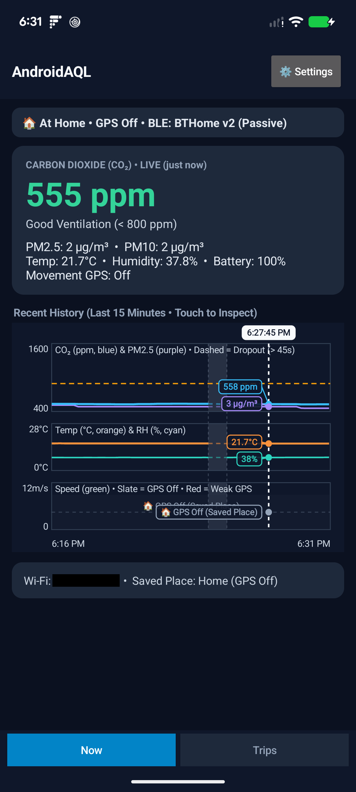
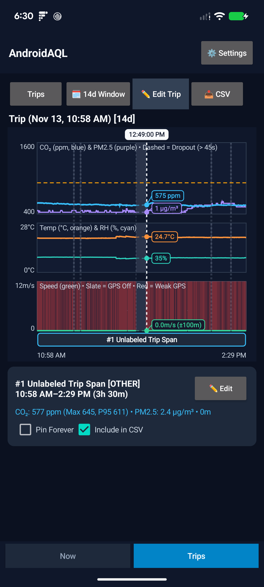
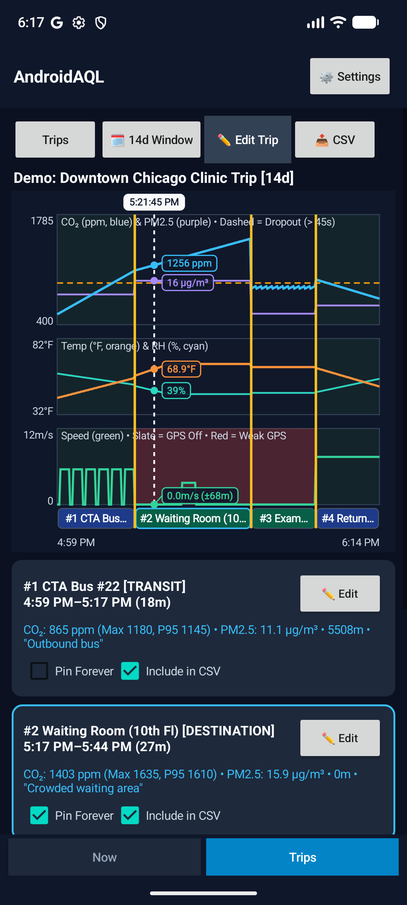
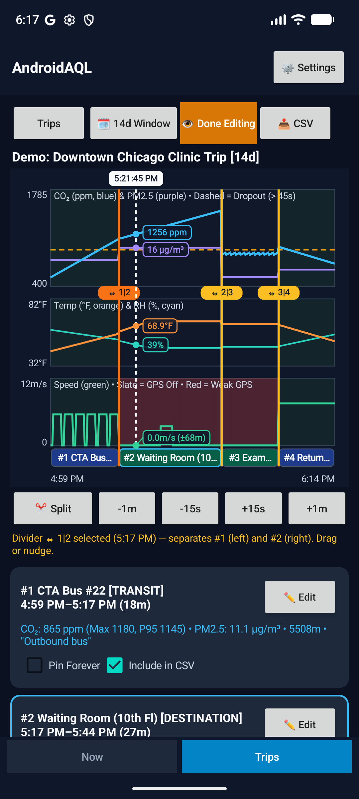
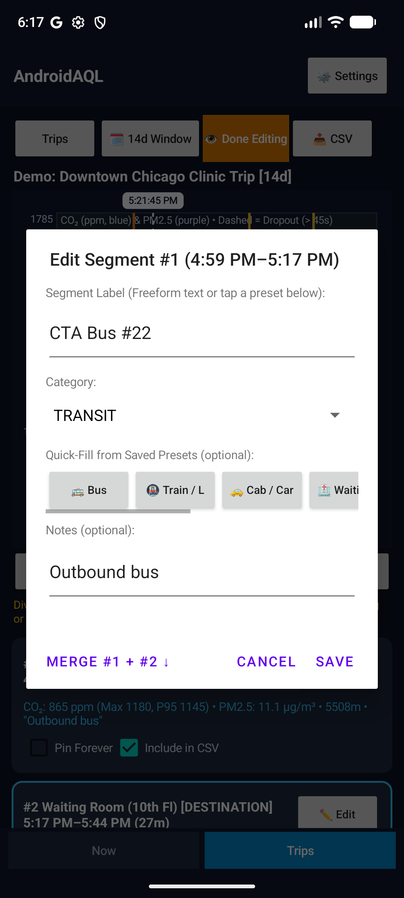
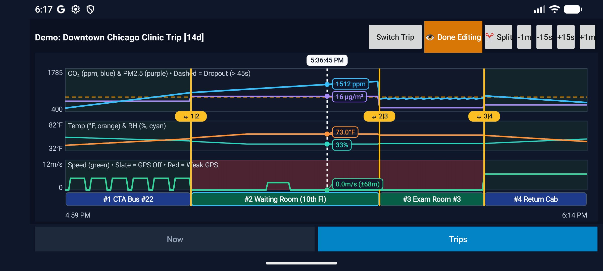

# AndroidAQL — Portable Qingping Air Monitor Lite (`CGDN1`) Companion

**`AndroidAQL`** is an Android application (**Android 13+ / API 33+**) that turns a **Qingping Air Monitor Lite (`CGDN1`)** into a pocketable, cloud-free, field-portable environmental recorder for **CO₂, PM2.5, PM10, Temperature, and Relative Humidity**; AQL stands for "Air Quality Logger".

| Live **Now** Dashboard (`BTHome v2` Passive BLE) | **Trips** — 3-Pane Synchronized Telemetry Timeline |
| :---: | :---: |
| [](docs/screenshots/now_dashboard.webp) | [](docs/screenshots/real_trip_overview.webp) |

---

## Why `AndroidAQL`? (Portable Bluetooth Recording vs. Stationary Wi-Fi)

The **Qingping Air Monitor Lite (`CGDN1`)** packs research-grade environmental sensors (Sensirion SCD40 CO₂ sensor, Plantower PMSA003I laser particulate sensor, and Sensirion SHT4x temperature/humidity sensor) into a compact, battery-backed enclosure. However, **its stock firmware and almost every existing third-party integration are built around a stationary, single-building use case**:

* **Stock Firmware & Other Clients Focus on Fixed-Location Wi-Fi + MQTT:**
  In its intended desktop setup, the `CGDN1` sits plugged into wall power on a 2.4 GHz Wi-Fi network and pushes telemetry to Qingping Cloud, Xiaomi Home, or a local **MQTT** broker. Consequently, almost all third-party clients and integrations (Home Assistant MQTT bridges, stationary BLE-to-MQTT hubs like ESPHome/OpenMQTTGateway, and web dashboards) assume the monitor lives on a shelf in one room with permanent Wi-Fi and mains power.
* **Why Stock Firmware Fails in Mobile Use:**
  As soon as you unplug the `CGDN1` and carry it out the door (into an elevator, onto a bus or train, or into an office, clinic, or restaurant), your home Wi-Fi and MQTT server are out of reach. Worse, out of the box (before initial setup), the monitor's Bluetooth is off—and if you hold the top touch-bar for ~7 seconds to wake Bluetooth, it enters **Wi-Fi setup mode** (replacing the normal CO₂ readout with a static Wi-Fi setup icon) and shuts Bluetooth back down after **1 to 30 minutes**. Normally, getting the monitor out of setup mode so it broadcasts continuously requires the proprietary Qingping+ or Xiaomi app, a user account, and a live 2.4 GHz Wi-Fi network.
* **How `AndroidAQL` Approaches Portable Field Collection:**
  1. **Direct Phone-to-Monitor Bluetooth Recording (Zero Wi-Fi or Cloud Needed):** `AndroidAQL` receives live readings directly from your `CGDN1` over Bluetooth Low Energy on your Android phone—anywhere you carry it, with no internet connection, cloud account, or MQTT broker required.
  2. **Automatic 5-Second Offline Setup (Continuous Bluetooth • Normal Anti-Burn-In Screen):** If you hold the touch-bar for ~7 seconds on an unconfigured monitor, `AndroidAQL` completes setup offline over Bluetooth in ~5 seconds, restores the normal pixel-shifting CO₂ display, and unlocks continuous passive Bluetooth broadcasts—with no Wi-Fi network or vendor app required. Already-configured monitors stay untouched and passive.
  3. **Privacy-by-Default Location & Movement Correlation:** When you are at a configured **Saved Wi-Fi Place** (e.g., Home) or when the monitor is turned off or out of range for 90 seconds, `AndroidAQL` turns GPS polling off (`0 mW`). When you leave a Saved Wi-Fi Place with your monitor active, `AndroidAQL` opens a **Field Excursion** and records movement speed and GPS accuracy alongside your air quality readings.
  4. **Retrospective Trip Slicer & Self-Contained CSV Export:** Instead of making you fiddle with start/stop buttons while walking or riding transit, `AndroidAQL` records continuously into a constant-size (`3.79 MB`) on-device ring buffer. After your outing, you can scrub a synchronized **3-Pane Graph Stack**, split the trip into named segments, pin those slices so they are never overwritten, and export self-contained RFC 4180 CSV reports for analysis or indoor-air-quality advocacy.

| Capability | Stock Qingping / MQTT Clients | `AndroidAQL` |
| :--- | :--- | :--- |
| **Primary Transport** | 2.4 GHz Wi-Fi + Cloud / Local MQTT broker | Direct Bluetooth Low Energy to Android phone |
| **Target Use Case** | Stationary room monitor on fixed Wi-Fi | Mobile excursions (transit, offices, clinics, elevators) + stationary monitoring |
| **Works Outside Home Wi-Fi?** | ❌ Loses connectivity as soon as you leave your AP | ✅ Collects over Bluetooth anywhere with your phone |
| **Unconfigured Setup & Sleep Limits** | ❌ Bluetooth stays off or sleeps after 1–30m until set up via Qingping+ & Wi-Fi | ✅ **Automatic 5-second offline setup** + continuous passive recording (anti-burn-in OLED restored) |
| **Retrospective Trip Slicing** | ❌ Continuous unsegmented stream | ✅ Interactive 3-pane timeline slicer with named segments & notes |
| **Cloud / Account Dependency** | Typically requires Qingping/Xiaomi app or local server | **None** — 100% local on-device storage and direct CSV export |

---

## Getting Started & Multi-Hour Field Trips

1. **First-Time Setup (or Waking Bluetooth on a Reset Monitor):**
   Turn your `CGDN1` on. If it is already set up, `AndroidAQL` starts recording passively right away. If it has never been set up (or `AndroidAQL` shows `📡 Monitor Out of Range`), hold the top capacitive touch-bar for **~7 seconds** until the static Wi-Fi icon appears on the screen:
   * `AndroidAQL` will automatically complete setup offline over Bluetooth in **~5 seconds** with no Wi-Fi network or vendor app required.
   * Within a few seconds, the monitor clears the static Wi-Fi icon back to its normal pixel-shifting CO₂ screen and streams continuous passive readings indefinitely.
2. **Multi-Hour Trips & External USB-C Power Bank Tip:**
   Because the `CGDN1` continuously powers an active CO₂ sensor, laser particulate fan, OLED screen, and wireless radio, its internal battery runs for roughly **1.5 to 3 hours**. For longer outings (such as clinic visits, travel days, or multi-hour fieldwork), **connect the monitor to a small external USB-C power bank** in your bag or pocket.
3. **Support for ESPHome / BTHome v2 Firmware:**
   If you run custom firmware such as **ESPHome** on your `CGDN1` (or another compatible environmental monitor), `AndroidAQL` detects and decodes unencrypted **BTHome v2 (`0xFCD2`)** broadcasts passively out of the box with zero app-side configuration changes. Because ESPHome's standard `esp32_ble_tracker` and `bluetooth_proxy` components only *scan* by default and do not advertise local sensor values, include a BTHome v2 BLE advertisement block in your ESPHome YAML—or build the `dev` branch of [`charles-dyfis-net/esphome-qingping-cgdn1`](https://github.com/charles-dyfis-net/esphome-qingping-cgdn1/tree/dev) (forked from [`nemethhh/esphome-qingping-cgdn1`](https://github.com/nemethhh/esphome-qingping-cgdn1)) with `-s portable true -s bthome true` for a build tuned for portable `AndroidAQL` use rather than stationary Home Assistant / ESPHome use (see **[How Your Monitor Works with `AndroidAQL`](docs/how_cgdn1_works.md)**).
4. **Want to Know How It Works Under the Hood?**
   * Read **[How Your Monitor Works with `AndroidAQL`](docs/how_cgdn1_works.md)** for a non-wire-level explanation of the monitor's setup vs. normal modes, Bluetooth sleep timers, offline setup flow, and fallback keep-alive options in **⚙️ Settings**.
   * Read **[Physical Hardware Observations (`CGDN1`)](docs/hardware_observations.md)** for byte-level protocol details, GATT UUIDs, and hardware traces.

---

## Key Features & Workflow

### 1. Live **"Now"** Dashboard (`15m` Recent History)
* Displays real-time **CO₂ (`ppm`)**, **PM2.5 / PM10 (`µg/m³`)**, **Temperature (`°F` / `°C`, locale-aware)**, **Relative Humidity (`%`)**, and **Battery (`%`, when supported by firmware)** with automatic stale-signal visual dimming if the monitor goes out of range.
* Includes a synchronized 15-minute 3-pane rolling chart stack right on the home screen.

### 2. Synchronized 3-Pane **Trip Slicer & History**
* **Pane 1 — Air Quality:** CO₂ (`ppm`) & PM2.5 (`µg/m³`) with non-overlapping scrubber callout pills and leader lines.
* **Pane 2 — Thermal Comfort:** Temperature & Relative Humidity (`%`).
* **Pane 3 — Mobility & Context:** Movement speed (`m/s`, cumulative-anchor filtered to suppress stationary indoor GPS jitter), amber shading for weak/urban-canyon GPS (`> 50 m`), and green bands for `🏠 GPS Off (Saved Place)`.
* **View vs. Edit Modes & Zero-Scroll Landscape:** Clean read-only scrubbing by default with a color-coded **Segment Strip** (`#1`, `#2`, ...) directly below Pane 3; toggle **Edit Mode** to drag shared `⇔ 1|2` divider boundaries, nudge dividers or the cursor by `-1m / -15s / +15s / +1m`, split segments at the cursor, and label each leg (Category, Location/Activity Label, Notes). Rotate to **Landscape** to see all three panes simultaneously with zero vertical scrolling. See **[How Trips, Segments, and Splits Work](docs/trip_slicing_guide.md)**.

### 3. **BLE & Hardware** Diagnostic Testbench & Provisioning CLI
* **Gated behind `🛠️ Developer Mode` (off by default):** Toggle **`⚙️ Settings → Diagnostics & Support → 🛠️ Developer Mode`** to reveal the **`3. HW Test`** tab (live BLE/GATT inspector and experiment controls) along with UI options that inject demo data or simulate Saved Wi-Fi Places.
* **Security & privacy implications of enabling Developer Mode:**
  * **Verbose BLE frame logging to disk:** Enables recording `BLE_ADV_FDCD`, `BLE_ADV_FDCD_UNPARSED`, and `BLE_ADV_NON_FDCD` frames into the persistent `5 MB` × 2 diagnostic trace (`files/hw_bringup_trace.jsonl` / `.prev`), including MAC addresses, device names, RSSI, service UUIDs, and raw hex payloads of nearby third-party BLE beacons (which are included if you share the JSONL trace).
  * **`DEV_COMMAND` intent authorization on release builds:** Because `MainActivity` is `android:exported="true"`, enabling Developer Mode sets `isDevCommandAuthorized = true` on non-debug builds and allows `adb` or local processes that launch `MainActivity` with `net.dyfis.androidaql.DEV_COMMAND` to push Wi-Fi credentials, run raw `gatt_script` commands, queue `ota_url` firmware updates, or modify keep-alive settings. Turn Developer Mode off after hardware testing or provisioning.
* Paired with [`scripts/analyze-hw-trace`](scripts/analyze-hw-trace) (when `DEV_COMMAND` is authorized via a debug build or Developer Mode; see [Physical Hardware Observations, §6.0](docs/hardware_observations.md#60-developer-mode-and-security--privacy-surface) for full details):
  * `--wifi-ssid "<2.4GHz-SSID>" --wifi-password-stdin`: Connects a stock `CGDN1` to a 2.4 GHz Wi-Fi network over Bluetooth (Pair B Wi-Fi scan + association + local `127.0.0.1` MQTT provisioning) without installing the first-party Qingping+ or Xiaomi Home app (`:` / `;` in credentials are handled safely, and passwords are redacted from trace logs).
  * `--gatt-script`: Queues raw Bluetooth GATT diagnostic command scripts.
  * `--ota-url <http://...>`: Triggers **stock-firmware-only** Pair B `cmd 0x03` HTTP firmware upgrades over Wi-Fi without an MQTT server, using the same CRC32-trailer verification path as MQTT OTA for initial migration to firmware such as ESPHome (hardware-verified to flash `.crc.bin` images `1%`..`100%` in ~76s over direct plain `http://` `200 OK`—no `301`/`302` redirects and no `https://`); once running ESPHome, use ESPHome's own OTA tools (**use at your own risk**: flashing incompatible or improperly formatted images can brick the unit).

### Screenshots — 3-Pane Trip Slicer

| View Mode | Edit Mode (`⇔ 1\|2` Dividers) | Segment Editor | Zero-Scroll Landscape |
| :---: | :---: | :---: | :---: |
| [](docs/screenshots/trips_view_mode.webp) | [](docs/screenshots/trips_edit_mode.webp) | [](docs/screenshots/trips_segment_edit.webp) | [](docs/screenshots/trips_landscape.webp) |

---

## Documentation

* **[How Trips, Segments, and Splits Work](docs/trip_slicing_guide.md)** — End-user guide with screenshots explaining segments (`#1`, `#2`, ...), shared dividers (`⇔ 1|2`), splitting, nudging, labeling, merging, permanent pinning, zero-scroll landscape mode, and CSV export.
* **[How Your Monitor Works with `AndroidAQL`](docs/how_cgdn1_works.md)** — Conceptual guide for curious users covering sensors inside the `CGDN1`, battery runtime, Setup Mode vs. Normal Mode, 5-second offline setup, fallback settings, and ESPHome support.
* **[Reference ESPHome Fork (`charles-dyfis-net/esphome-qingping-cgdn1`, `dev` branch)](https://github.com/charles-dyfis-net/esphome-qingping-cgdn1/tree/dev)** — Hardware-tested fork of [`nemethhh/esphome-qingping-cgdn1`](https://github.com/nemethhh/esphome-qingping-cgdn1); compile with `-s portable true -s bthome true` for a configuration tuned for portable `AndroidAQL` use with passive BTHome v2 (`0xFCD2`) BLE broadcasts.
* **[Requirements & Architecture Specification](docs/requirements_spec.md)** — State machine, decoupled BLE timeouts, 3-mode BLE/GATT privacy strategy, data model, 3-pane graph stack, View/Edit & Portrait/Landscape ergonomics, and hardware bring-up logger.
* **[Physical Hardware Observations (`CGDN1`)](docs/hardware_observations.md)** — Empirical and firmware-verified wire-protocol reference for `CGDN1` (`Firmware 4.8.5`, Product ID `0x24`), including ESP32-WROVER-B internals, dual-MAC radio behavior (`:BA` vs. `:BC`), the `7.2 s` touch-slider reset, Bluetooth timers, SHT4x self-heating, and the full GATT characteristic/command map.
* **[Binary Ring-Buffer Format (`.aqlring`)](docs/binary_storage_format.md)** — Byte-level specification of the constant-size (`3.79 MB`) multi-archive circular time-series store (`AQLRING1`) and pinned slice blobs (`AQLP`).
* **[CSV Export Schema](docs/csv_export_schema.md)** — Self-contained 27-column RFC 4180 CSV export contract designed to feed external PDF/advocacy report generators.
* **[Privacy Policy](docs/PRIVACY_POLICY.md)** — Local-only privacy disclosure for Google Play (`net.dyfis.androidaql`).

---

## Building & Running Tests

```bash
./gradlew test assembleDebug
```
