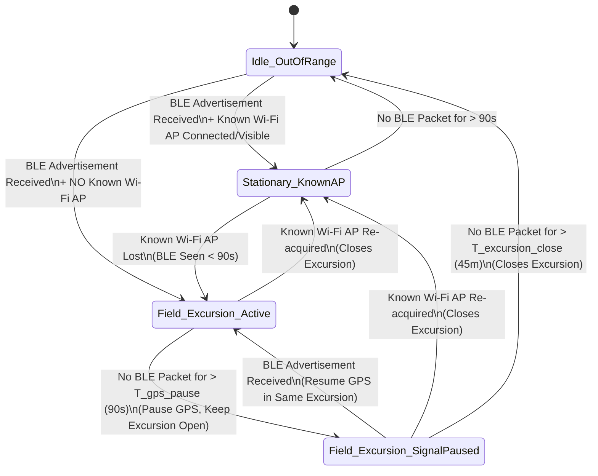
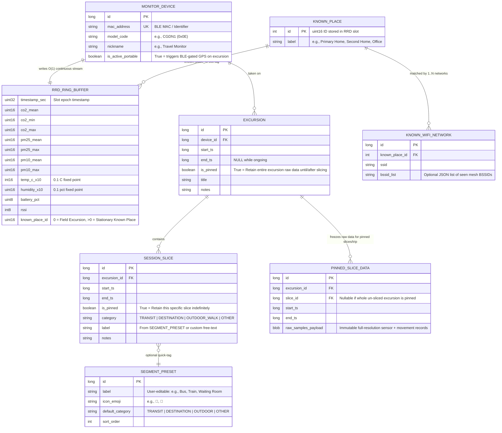
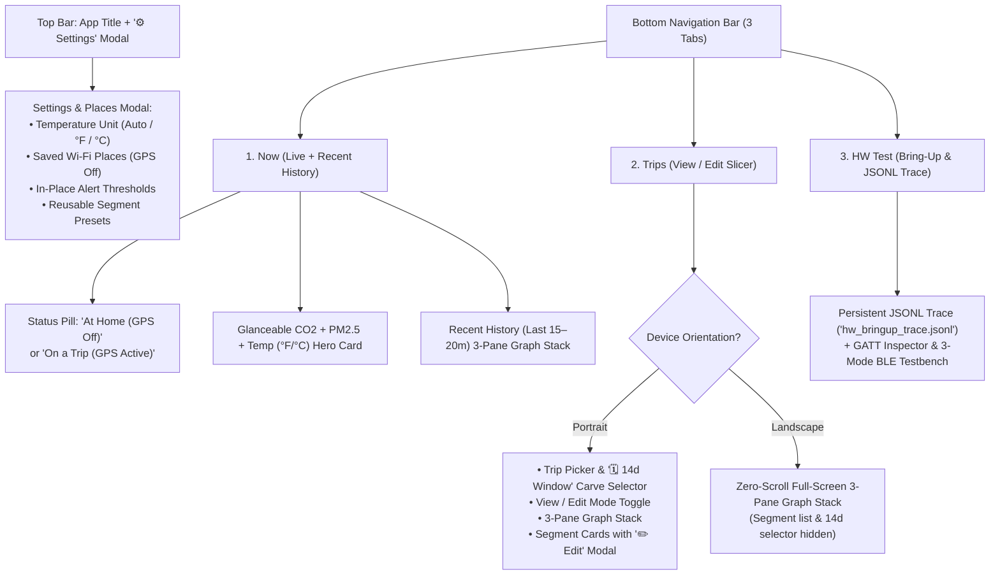

# Requirements Specification: Portable Qingping Air Monitor Lite (`CGDN1`) Logger

## 1. Purpose & Core Value Proposition
An Android application designed to collect, analyze, and export environmental data ($\text{CO}_2$, PM2.5, PM10, Temperature, Humidity) from a **Qingping Air Monitor Lite (`CGDN1`)** with first-class support for **portability and advocacy**:
1. **Home vs. Field Context Awareness:** Automatically distinguish between stationary monitoring at known "Home" locations (via known Wi-Fi APs) and portable excursions (transit + destinations).
2. **Retrospective Session Slicing:** Allow users to divide and adjust excursion timelines *after the fact* into distinct segments (e.g., *Bus Ride Out*, *Waiting Room*, *Exam Room*, *Cab Ride Back*) by inspecting synchronized air quality and movement speed/accuracy charts.
3. **Advocacy-Grade Retention & Privacy by Default:** Retain full-resolution telemetry during a review window and indefinitely for flagged/pinned excursions (e.g., to share air quality evidence for healthcare/facility advocacy), while automatically rolling up unflagged/stationary data over time and discarding GPS coordinates by default.

---

## 2. System State Machine & Privacy-Preserving Telemetry

Location and movement collection is **strictly gated on active BLE presence** of the paired Air Monitor Lite. If the user leaves home *without* the monitor, the app must never log location or movement.

### 2.1 Decoupled Timeout Thresholds & Excursion Confirmation
To handle real-world RF occlusion (e.g., monitor muffled inside a backpack on the CTA, or stepping out of an exam room for 3 minutes while leaving the bag on a chair) without either draining battery/logging phantom trips or fragmenting a single outing into multiple excursions:
* **Post-Wi-Fi-Disconnect BLE Confirmation (Anti-Phantom-Trip Gate):** Because Home Wi-Fi can reach the sidewalk or drop 30–60 seconds *after* the user walks out the front door leaving the monitor behind at home, a trip is only marked **Confirmed Portable** once at least $K$ BLE packets (default: $K = 2$ packets or $\ge 30\text{s}$ of BLE presence) are received *after* Known Wi-Fi disconnects. If no BLE packets arrive after Wi-Fi disconnects, the tentative excursion is silently discarded at `T_gps_pause` with zero alerts.
* **`T_gps_pause` (Default: 90 seconds):** How quickly `FusedLocationProviderClient` is stopped after the last received `CGDN1` BLE packet. Protects battery and privacy immediately if the user walks away from the monitor.
* **`T_signal_lost_alert` (Default: 180 seconds / ~12–18 missed packets, configurable):** When a **Confirmed Portable** excursion remains in `Field_Excursion_SignalPaused` beyond this window, the app triggers an in-place **Monitor Signal Lost** remediation alert (see Section 6.1) so the user can check whether the monitor hit its battery auto-power-off timer or was accidentally left behind at a stop.
* **`T_excursion_close` (Default: 45 minutes, configurable):** How long an ongoing `EXCURSION` remains open in `Field_Excursion_SignalPaused` waiting for the monitor's BLE advertisements to resume (unless closed immediately by reconnecting to a Known Wi-Fi AP or manual user action).

### 2.2 State Definitions
| State | Entry Condition | Active Sensors / Collectors | Location / Privacy Behavior |
| :--- | :--- | :--- | :--- |
| **`Idle_OutOfRange`** | No BLE advertisement within `T_gps_pause` (from Stationary) or `T_excursion_close` (from Excursion). | Low-power hardware-filtered BLE scan (`0xFDCD` + device MAC) only. | **GPS Off.** Zero data logged. |
| **`Stationary_KnownAP`** | `CGDN1` BLE packet seen within `T_gps_pause` **AND** a configured "Known Place" Wi-Fi AP (matched by BSSID or SSID) is connected/visible. | BLE advertisement parser (`qingping.py` `0x0E` payload). | **GPS Off.** Samples tagged with `known_place_id` (e.g., *"Home"*, *"Partner's Apt"*). |
| **`Field_Excursion_Active`** | `CGDN1` BLE packet seen within `T_gps_pause` **AND** no Known Place Wi-Fi AP is visible. | BLE advertisement parser + `FusedLocationProviderClient` + `GpsMovementFilter`. | **Scalar Movement by Default:** Logs filtered `speed_mps`, `delta_distance_m`, and `horizontal_accuracy_m`. Raw `lat`/`lon` discarded in-memory unless opt-in enabled. |
| **`Field_Excursion_SignalPaused`** | In an active Excursion, but no `CGDN1` BLE packet seen for `> T_gps_pause` (and `< T_excursion_close`). | Low-power BLE scan waiting for monitor to reappear. | **GPS Paused.** Parent `EXCURSION` stays open so returning to the bag resumes the same trip seamlessly. |

### 2.3 Uncertainty-Gated Cumulative Anchor Filter (`GpsMovementFilter`)
To prevent stationary GPS jitter (e.g., while sitting in a waiting room) from logging false velocity spikes without ignoring real walking whose per-sample steps are smaller than the horizontal inaccuracy radius:
* **Why Naive Sample-to-Sample Suppression Fails:** At a normal walking pace ($1.3\text{ m/s}$) with a $5\text{s}$ GPS update interval, each consecutive fix is only $\sim 6.5\text{ m}$ apart. Under typical urban GPS accuracy ($\sigma \approx 12\text{–}18\text{ m}$), every single step is smaller than $\sigma$, so suppressing individual steps where $\text{dist}(P_t, P_{t-1}) \le \sigma_t$ would zero out 100% of real walking.
* **Cumulative Anchor Deadband with Breakout (`GpsMovementFilter`):**
  1. Maintains an in-memory reference **Anchor Fix** $(P_{\text{anchor}}, t_{\text{anchor}}, \sigma_{\text{anchor}})$ strictly in volatile RAM (wiped immediately when GPS stops).
  2. For each new fix $(P_t, t, \sigma_t)$, computes the cumulative displacement from the anchor $d_{\text{anchor}} = \text{haversine}(P_{\text{anchor}}, P_t)$ and the combined two-fix horizontal uncertainty radius:
     $$R_{\text{noise}} = \max\left(R_{\text{min}}, \alpha \sqrt{\sigma_{\text{anchor}}^2 + \sigma_t^2}\right)$$
     where $R_{\text{min}} = 6\text{ m}$ and $\alpha = 1.0$ under normal lock ($\sigma \le 50\text{ m}$) or $\alpha = 1.35$ in weak-GPS indoor/urban-canyon zones ($\sigma > 50\text{ m}$).
  3. **Inside Uncertainty Circle ($d_{\text{anchor}} \le R_{\text{noise}}$):** Movement is suppressed (`speed_mps = 0`, `delta_distance_m = 0`). If the new fix has a tighter horizontal accuracy ($\sigma_t < \sigma_{\text{anchor}}$), the anchor position and accuracy tighten without resetting $t_{\text{anchor}}$.
  4. **Cumulative Breakout ($d_{\text{anchor}} > R_{\text{noise}}$):** Once cumulative movement exits the uncertainty circle (even across multiple walking steps), the anchor advances to $(P_t, t, \sigma_t)$ and credits the displacement over $\Delta t = t - t_{\text{anchor}}$ (subtracting $\sqrt{\sigma_{\text{anchor}}^2 + \sigma_t^2}$ when accuracy is degraded $>25\text{ m}$ so urban-canyon multipath jumps do not inflate speed).

---

## 3. Storage Architecture & Data Model

### 3.1 Hybrid Storage Strategy: RRD/Whisper Binary Ring Buffers + SQLite Metadata
Using SQLite for continuous 10–15 second time-series ingestion (`~8,640 rows/day`) introduces unnecessary B-tree fragmentation, WAL write amplification, and periodic `DELETE`/`VACUUM` maintenance jobs. Instead, the storage layer separates **fixed-size circular time-series storage** from **relational metadata**:

1. **Constant-Size Circular Time-Series Store (Whisper / RRD4J / Custom Binary Ring Buffer):**
   * Pre-allocated binary file(s) per `MONITOR_DEVICE` using fixed-width binary slots accessed via `FileChannel` / `RandomAccessFile` (either via pure-JVM **`RRD4J`** or a lightweight custom Whisper-style multi-archive ring buffer).
   * **Inline Rollup on Write:** Consolidation (`MEAN`, `MIN`, `MAX`, `COUNT`) into lower-resolution archives happens in $O(1)$ as high-resolution slots advance—no background SQLite compaction or pruning jobs required.
   * **Predictable, Constant Disk Footprint:**
     * *Archive 0 (Full-Res, 15s step, 14-day retention):* $80,640\text{ slots} \times 28\text{ bytes} \approx \mathbf{2.25\text{ MB}}$
     * *Archive 1 (Medium-Res, 5m step, 90-day retention):* $25,920\text{ slots} \times 28\text{ bytes} \approx \mathbf{0.72\text{ MB}}$
     * *Archive 2 (Long-Term, 1h step, 2-year retention):* $17,520\text{ slots} \times 28\text{ bytes} \approx \mathbf{0.49\text{ MB}}$
     * *Movement Ring Buffer (15s step, 14-day retention):* $80,640\text{ slots} \times 16\text{ bytes} \approx \mathbf{1.29\text{ MB}}$
     * **Total Constant Footprint per Monitor:** **$< 5\text{ MB}$** on disk forever.
2. **Pinned Excursion Archive ("Freeze on Pin"):**
   * During the 14-day full-resolution window (Archive 0), retrospective session slicing reads directly from the ring buffer.
   * When a user flags an `EXCURSION` for indefinite retention (`is_pinned = true`), the raw Archive 0 sensor and movement slots covering `[excursion.start_ts, excursion.end_ts]` are copied into a dedicated immutable **Pinned Excursion Store** (either a per-excursion binary/CSV/SQLite archive table), allowing the ring buffer to keep wrapping around indefinitely without losing advocacy data.
3. **SQLite (Room) Strictly for Low-Volume Relational Metadata:**
   * Stores `MONITOR_DEVICE`, `KNOWN_PLACE`, `EXCURSION`, and `SESSION_SLICE` (hundreds of rows total).

### 3.2 Multi-Pane Slicing UI Requirements (AQ + Temp/Humidity + Speed/Accuracy)
* **Synchronized 3-Pane Time Axis (`DualPaneSlicerView`):**
  * **Pane 1 — Upper (Air Quality, 42% height):** Plots $\text{CO}_2$ ($\text{ppm}$, blue) and **PM2.5 ($\mu\text{g/m}^3$, purple, enabled by default)** on a dual scale with a $1000\text{ ppm}$ dashed reference threshold.
  * **Pane 2 — Middle (Microclimate, 29% height):** Plots **Temperature (orange)** and **Relative Humidity ($\%$, cyan)** with a parsimonious header (`"Temp (°F, orange) & RH (%, cyan)"` or `"°C"`), providing a clear physical signal for indoor/outdoor and transit/building HVAC transitions even when high-rise buildings block GPS.
  * **Pane 3 — Lower (Movement & Urban Canyon Context, 29% height):** Plots movement speed ($\text{m/s}$, green) when GPS collection is active (`knownPlaceId == 0 && speedMps != null`), visualizes `horizontal_accuracy_m > 50m` directly as a shaded red **"Weak GPS (>50m)"** band so downtown skyscraper multipath spikes are visually obvious, and renders intervals where GPS is disabled (such as at a recognized **Saved Place** like Home/Office or when `speedMps == null`) as a distinct slate **"🏠 GPS Off (Saved Place)"** (or **"GPS Off"**) band and callout rather than plotting a misleading green line sitting at $0\text{ m/s}$.
  * **Header Headroom & Inline Cursor Callouts:** Each pane reserves a `14dp` top header band so plotted lines never collide with pane titles. Scrubbing or tapping the chart draws a vertical cursor line with a **floating timestamp pill** at the top and **inline color-coded value badges** directly next to each curve intersection (with automatic vertical collision avoidance), eliminating the need for a separate external text header bar.
  * **Telemetry Dropout & Interpolation Visualization (Configurable Grace Period):**
    * Rather than silently drawing a solid straight line across arbitrary time gaps between non-adjacent samples (`slot[i].timestampEpochSec - slot[i-1].timestampEpochSec > gracePeriodSec`), the 3-pane graph stack must visually distinguish continuous telemetry from missing/interpolated intervals once a configurable dropout threshold is exceeded (e.g., default grace period of `45s` / `3` missed Archive 0 slots, configurable in **⚙️ Settings**):
      * **Within Grace Period (`Δt ≤ T_dropout_grace`):** Plotted as normal solid line segments.
      * **Beyond Grace Period (`Δt > T_dropout_grace`):** Rendered as either a **dashed/translucent bridge line** (or an explicit gap with a subtle vertical **"Signal Dropout"** hatch/shading band across the panes) so interpolated spans are immediately obvious and never mistaken for continuous live measurements.
      * **Cursor Scrubbing Inside a Dropout:** When scrubbing the cursor across a dropout interval, the inline callout badge indicates that the span is interpolated / missing telemetry rather than reporting a synthetic reading.
* **Device-Aware Temperature Unit Formatting (`TemperatureUnitFormatter`):**
  * While the binary `.aqlring` store and CSV export always preserve canonical Celsius (`0.1°C` fixed-point in binary storage; `temp_c` in CSV), all UI views (`1. Now` Hero card, foreground notification, and `DualPaneSlicerView` Y-axis labels and intersection badges) honor the Android device's configured Regional Preferences / Locale (`-u-mu-fahrenhe` / `-u-mu-celsius` and ICU `LocaleData.MeasurementSystem`, defaulting to **°F** for US locales), with an explicit user override (**Auto**, **°F**, **°C**) in **⚙️ Settings**.
* **Separate View vs. Edit Modes & Non-Destructive Boundary Editing:**
  * **View Mode (Default):** Hides divider drag handles (`⇔ 1|2`) and hides the boundary split/nudge toolbar while keeping the color-coded Segment Strip (`#1`, `#2`, ...) visible below Pane 3 so users can cleanly view and scrub the 3-pane timeline without visual clutter or accidental boundary edits.
  * **Edit Mode (`✏️ Edit Trip`):** Reveals the `⇔ 1|2` / `⇔ N|(N+1)` thumb pill handles on shared dividers and the **`✂️ Split` / `-1m` / `-15s` / `+15s` / `+1m`** single-row toolbar with contextual divider/cursor helper text. When no divider is selected yet (or before any split is created), the `-1m / -15s / +15s / +1m` buttons nudge the cursor line for precise split placement; when a divider is selected, they nudge that shared boundary.
  * **v1 Manual Slicing vs. v2 Auto-Drafting:** Newly recorded excursions open as a single contiguous timeline (`[start_ts, end_ts]`). Once real-world v1 trips and user-created `SESSION_SLICE` boundaries are collected, those manual slices will serve as ground-truth labeled data to tune and validate automatic boundary-detection heuristics for v2.
  * Statistics ($\text{CO}_2$ and PM2.5/PM10 min, max, time-weighted mean, median, 95th percentile, and minutes above threshold) recalculate live from the Archive 0 ring buffer (or `PINNED_SLICE_DATA` if pinned) within `[start_ts, end_ts]`.

---

## 4. Tiered Retention & Rollup Policy (Fixed-Size Multi-Archive Ring)

### 4.1 Protection Rules ("Pin Trip for Later Slicing" vs. "Pin Specific Slices for Advocacy")
* **14-Day Archive 0 Grace Window:** Because Archive 0 holds 14 days of raw 15-second slots in a fixed circular buffer, all excursions and stationary readings automatically retain full fidelity for 14 days without user action.
* **Two-Level Pinning (`EXCURSION.is_pinned` and `SESSION_SLICE.is_pinned`):**
  1. **Whole-Trip Bookmark ("Keep for Later Slicing"):** Toggling `EXCURSION.is_pinned = true` (e.g., from the notification button or trip list when the user doesn't have time to slice within 14 days) freezes the entire excursion's raw Archive 0 data into `PINNED_SLICE_DATA`.
  2. **Per-Slice Advocacy Pinning:** Once a user splits an excursion into segments (e.g., *Outbound Bus*, *Clinic Waiting Room*, *Exam Room*, *Return Bus*), they can pin **individual slices** (`SESSION_SLICE.is_pinned = true`) and unpin the parent excursion—retaining high-resolution data indefinitely *only* for the relevant segments (e.g., the clinic visit) while letting unneeded transit segments age out cleanly.

### 4.2 Default Multi-Archive Ring Specification
Each `MONITOR_DEVICE` ring buffer file is pre-allocated with three consolidation archives (preserving `mean`, `min`, and `max` across rollups):

| Archive Tier | Step Size | Retention Horizon | Slot Count | Purpose |
| :--- | :--- | :--- | :--- | :--- |
| **Archive 0 (High-Res)** | **15 sec** | **14 days** | `80,640` | Full-resolution window for retrospective excursion slicing and recent home monitoring. |
| **Archive 1 (Medium-Res)** | **5 min** (`300s`) | **90 days** | `25,920` | Medium-term trends with preserved `min`/`max` peaks. |
| **Archive 2 (Long-Term)** | **1 hour** (`3600s`) | **2 years** | `17,520` | Multi-year seasonal/baseline comparison at fixed $< 0.5\text{ MB}$ size. |

### 4.3 Gap Handling (Advance-and-Clear)
When the monitor is powered off or out of range, time advances across ring buffer slots (`slot_index = (timestamp_sec / step_sec) % slot_count`). On every write, if `current_slot_ts > last_written_slot_ts + step_sec`, all intermediate skipped slots are zeroed (`sample_count = 0`) before writing the new slot so stale data from a prior 14-day cycle is never read back as current. Higher-tier rollups (5m / 1h) compute `mean`/`min`/`max` across slots with `sample_count >= 1` and record the actual `sample_count`.

---

## 5. Advocacy Export & Reporting Scope

### 5.1 Self-Contained CSV Export (MVP)
To allow an external desktop/CLI tool to generate rich PDF advocacy reports directly from a single exported CSV without needing direct database access, the CSV export denormalizes the time series together with its active `EXCURSION`, `SESSION_SLICE`, and nearest/interpolated movement context:

| Column Group | Columns Included |
| :--- | :--- |
| **Time & Resolution** | `timestamp_iso8601` (with local timezone offset), `timestamp_epoch_ms`, `resolution_sec`, `sample_count` |
| **Device Metadata** | `device_nickname`, `device_model`, `source_type` (`BLE_ADV`) |
| **Context & Slice Metadata** | `excursion_id`, `excursion_title`, `slice_id`, `slice_category` (`TRANSIT`, `DESTINATION`, etc.), `slice_label` (e.g., `"Waiting Room"`), `slice_notes`, `known_place_label` |
| **Air Quality Metrics** | `co2_ppm_mean`, `co2_ppm_min`, `co2_ppm_max`, `pm25_ugm3_mean`, `pm25_ugm3_max`, `pm10_ugm3_mean`, `pm10_ugm3_max`, `temp_c`, `humidity_pct` |
| **Movement & Signal** | `speed_mps`, `delta_distance_m`, `gps_accuracy_m`, `activity_type`, `rssi_dbm`, `battery_pct` (+ `latitude`, `longitude` only if opt-in enabled and user checks *"Include coordinates in export"*) |

### 5.2 Visual Summary Card (Nice-to-Have / Post-MVP)
An in-app shareable image card (PNG rendered via Compose Canvas) summarizing an excursion or specific slice with:
* Annotated timeline chart with color-coded session slices (e.g., Transit → Waiting Room → Exam Room)
* Per-slice summary table (Duration, Mean $\text{CO}_2$, Peak $\text{CO}_2$, Mean/Peak PM2.5)
* Privacy-safe header (customizable title & date; no MAC addresses or Wi-Fi SSIDs)

---

## 6. Configurable Real-Time Threshold & Low-Battery Alerts (In-Place Lifecycle)

Users can configure local notifications when air quality degrades beyond user-defined thresholds ($\text{CO}_2$, PM2.5) or when the **Qingping monitor's battery runs low (`BATTERY_LOW`, default Warning $\le 20\%$, Critical $\le 10\%$, auto-clearing at $\ge 25\%$)**, managed as **stateful, in-place notifications** rather than a spammy log of discrete alert events:

* **Deterministic Notification IDs & In-Place Updates:**
  * Active alerts are keyed by `(device_id, metric_type)` using a stable Android notification ID.
  * While a metric remains above threshold, subsequent BLE packets update the **existing** notification in-place using `setOnlyAlertOnce(true)`—displaying the **current value**, **peak value** during this excursion/spike, **time above threshold**, and **trend arrow** ($\uparrow$ rising / $\downarrow$ falling) without re-playing sound or vibration.
* **Automatic In-Place Clearing:**
  * As soon as the metric drops below `threshold - hysteresis_margin` (e.g., drops below $850\text{ ppm}$ after a $1000\text{ ppm}$ trigger) or the monitor goes out of BLE range, the notification is automatically dismissed in-place via `NotificationManager.cancel(notificationId)`.
* **Implicit Snooze on User Dismissal:**
  * If the user manually swipes away an active alert while the metric is still elevated, a `deleteIntent` marks the current spike as acknowledged so in-place updates do not re-post the notification unless the reading either (a) drops below the hysteresis recovery threshold and spikes again later, or (b) crosses into a higher configured severity tier (e.g., escalating from *Warning* at $1000\text{ ppm}$ to *Critical* at $2000\text{ ppm}$).
* **Context Scoping & Persistence:**
  * Rules can be scoped to *Field Excursions Only*, *Known Places (Home) Only*, or *Always*, and require $N$ consecutive seconds (default 30s) above threshold before initial trigger.

### 6.1 Excursion Signal-Lost Remediation Alert
Entering `Field_Excursion_SignalPaused` during a confirmed portable trip indicates one of three situations: (1) brief RF shadowing, (2) the `CGDN1` hit its battery auto-power-off timer inside the user's bag, or (3) the user accidentally left the monitor behind at a destination.
* **Gated Trigger (`T_signal_lost_alert`, default 180s or `N` missed packets):**
  * Only fires if the excursion was **Confirmed Portable** (received BLE packets *after* leaving Known Wi-Fi) and has remained in `Field_Excursion_SignalPaused` for `>= T_signal_lost_alert` (filtering out brief RF dropouts).
* **In-Place Notification & Quick Remediation Actions:**
  * Uses a dedicated notification ID (`NOTIFICATION_ID_SIGNAL_LOST`), updating elapsed time since last packet in-place with `setOnlyAlertOnce(true)`:
    * *Title:* `⚠️ Monitor Signal Lost (3m ago)`
    * *Body:* `Check if your Qingping monitor powered off on battery or was left behind.`
    * *Action 1:* **`End Trip Now`** (immediately closes the excursion at `last_ble_packet_ts` and transitions to `Idle_OutOfRange` if the user intentionally turned it off or left it somewhere safe).
    * *Action 2:* **`Snooze (15m)`** (if the user stepped away from their bag intentionally, e.g., for an X-ray down the hall).
* **Automatic In-Place Clearing:**
  * As soon as a single valid `0xFDCD` BLE packet is received again (e.g., the user presses the power button to wake the monitor or returns to their bag), `NotificationManager.cancel(NOTIFICATION_ID_SIGNAL_LOST)` clears the alert automatically.

---

## 7. Qingping BLE Wire Protocol Reference (`bleparser/qingping.py`)

The Qingping Air Monitor Lite (`CGDN1`) broadcasts passive BLE advertisements containing Service Data for 16-bit Service UUID **`0xFDCD`**:

* **Service Data Header (8 bytes):**
  * Byte `0`: Frame control flags (`0x08` or similar; bit `0x40` indicates event/binding frame)
  * Byte `1`: Product / Device Type ID → **`0x0E`** (or `0x24` on newer hardware revisions) for **CGDN1 (Air Monitor Lite)**
  * Bytes `2..7`: Reversed 6-byte MAC address (`mac[5]..mac[0]`)
* **TLV Payload (`xdata`, starting at Byte 8):**
  Repeated sequence of `(xdata_id: uint8, xdata_size: uint8, xdata_value: bytes[xdata_size])`:
  * **`0x01` (Length `4`):** Temperature & Humidity
    * `temp_c = int16_le(bytes[0..1]) / 10.0`
    * `humidity_pct = uint16_le(bytes[2..3]) / 10.0`
  * **`0x02` (Length `1`):** Battery
    * `battery_pct = uint8(bytes[0])` *(Note: empirically omitted in `0xFDCD` broadcasts by `CGDN1` `0x24` Firmware `4.8.5` on both external USB-C power and internal battery because the 31-byte BLE 4.x legacy advertisement PDU is 100% filled by TLVs `0x01`, `0x12`, and `0x13` — see [Physical Hardware Observations](hardware_observations.md); reported as sentinel `255`)*
  * **`0x12` (Length `4`):** Particulate Matter (PM2.5 & PM10)
    * `pm25_ugm3 = uint16_le(bytes[0..1])`
    * `pm10_ugm3 = uint16_le(bytes[2..3])`
  * **`0x13` (Length `2`):** Carbon Dioxide ($\text{CO}_2$)
    * `co2_ppm = uint16_le(bytes[0..1])`
* **Physical Hardware Pairing / Wakeup Behavior (`CGDN1` `0x24`, Firmware `4.8.5` — see [full empirical report](hardware_observations.md)):**
  * To initiate BLE broadcasts on an unpaired `CGDN1`, the user must **hold down the top capacitive touchbar until the Wi-Fi/radio icon displays** on the monitor's screen (rather than merely bringing the phone near the device).
  * When triggered, the unit broadcasts simultaneously from two MAC addresses: Xiaomi MiBeacon discovery frames + connectable GATT server (`0xFE95` on `MAC+2`, e.g., `58:2D:34:12:AB:BC` with device name `"Qingping Air Monitor Lite"`) and unencrypted non-connectable `0xFDCD` telemetry frames (`0x24` on `MAC`, e.g., `58:2D:34:12:AB:BA`) every ~320–1,670 ms.
  * Without a GATT connection, an unpaired `CGDN1` shuts off its BLE advertisements after **`~59 seconds`** (`58.97s` measured), and writing an unauthenticated **`05 09 <4B Unix epoch LE>` (`RTC Time Sync`)** command to `00000001-...` on `22210000-...` extends the `0xFDCD` broadcast window to **`~10 minutes`** (`609.0s` measured) without disturbing the monitor's primary anti-burn-in OLED UI (whereas read-only `0x180A` probes do not refresh the timer, and writing `11 01` Auth Init or `01 07` Wi-Fi AP Scan switches the OLED screen to the static Wi-Fi setup icon). Therefore, **`PERIODIC_GATT_KEEPALIVE` (a brief ~2s GATT `05 09` RTC Time Sync write on `MAC+2` every 3.5 minutes with a 15-second retry on connection timeout)** is the default collection mode in both `Field_Excursion_Active` and `Stationary_KnownAP` (Home), keeping the `0xFDCD` telemetry radio broadcasting 24/7 while preserving the primary OLED UI (`PASSIVE_ONLY` is retained only as an opt-in mode when an external hub already manages GATT keep-alive).
* **Packet Assembly Note:** Depending on firmware version, a single advertisement may include all TLVs or alternate between packet types within a few seconds. The collector should either merge TLVs received within a short window (e.g., 2–5 seconds) into a single sensor slot or carry forward the most recent value seen within the current sampling cadence.

---

## 8. UI/UX Requirements (Designed for Non-Technical Users)

Because the target end user is focused on health, transit, and advocacy rather than systems engineering, the UI must hide protocol/storage mechanics behind an approachable, low-friction workflow.

### 8.1 Plain-Language Terminology Mapping
| Internal / Spec Concept | User-Facing UI Term |
| :--- | :--- |
| `Stationary_KnownAP` (`known_place_id > 0`) | **"At [Place Name]"** (e.g., *"At Home • GPS Off"*) |
| `Field_Excursion` | **"Trip"** or **"Out & About"** |
| `SESSION_SLICE` | **"Stop or Ride"** / **"Segment"** |
| `is_pinned = true` | **"Saved Forever"** (Bookmark/Pin icon; protects from 14-day auto-cleanup) |
| `KNOWN_PLACE` (SSID / BSSID list) | **"Saved Wi-Fi Place"** |
| `horizontal_accuracy_m > 50m` | **"Weak GPS (Indoors / High-Rises)"** (shaded band on speed chart) |

### 8.2 Top-Level Navigation (3 Bottom Tabs + Top-Right Settings Modal)

### 8.3 Key Screen Workflows & Ergonomics

#### A. "Now" Screen (Live Telemetry + Recent-History 3-Pane Graph Stack) & Settings Modal
* **Live Statistics + Recent-History Graph Stack:** Below the context status pill and the live $\text{CO}_2$ / PM2.5 / Temperature Hero card, the **1. Now** tab renders a read-only **Recent History (Last 15–20 Minutes) 3-Pane Graph Stack** (`DualPaneSlicerView` with `isEditMode = false`) so the user can immediately see recent trends and touch/scrub to inspect values over the last several minutes.
* **Dedicated Settings Modal (`⚙️ Settings`):**
  * To keep the primary navigation parsimonious, **Saved Wi-Fi Places**, **Temperature Display Unit** (`Auto (Follow Device Settings)` / `°F` / `°C`), **In-Place Alert Thresholds**, and **Reusable Segment Presets** live inside the **`⚙️ Settings`** modal accessible from the top-right header bar.
* **Multiple Saved Places (Multiple Homes, Partner's Place, Office):**
  * When connected to any unrecognized Wi-Fi network, the **Now** screen and **⚙️ Settings** modal offer a **"+ Save Current Wi-Fi Place (Keep GPS Off Here)"** action with two choices:
    1. **Create a New Saved Place:** Prompt for a friendly name (e.g., *"Home"*, *"Second Home"*, *"Office"*). Each Saved Place gets its own `known_place_id` so stationary history is tracked distinctly per place while keeping GPS off at all of them.
    2. **Link to an Existing Saved Place:** Allows linking a 2.4GHz/5GHz band SSID, guest network, or another floor's AP to an already-created Saved Place (`KNOWN_WIFI_NETWORK` rows referencing the same `KNOWN_PLACE`).

#### B. Trip Timeline & Slicer Screen (`2. Trips`): View vs. Edit Mode, Portrait vs. Landscape, 14d Window Selector, and Segment Edit Modal
1. **Separate View and Edit Modes:**
   * **View Mode (Default):** Displays the 3-pane chart stack cleanly without divider drag pills (`⇔ #N`) or boundary editing buttons. Touching or dragging anywhere on the chart scrubs the inspection cursor and updates the inline intersection value badges.
   * **Edit Mode (`✏️ Edit Trip` / `👁️ Done Editing`):** Enables thumb-friendly `⇔ #N` divider pill handles and reveals the **`✂️ Split` / `-1m` / `-15s` / `+15s` / `+1m`** toolbar. If no divider is selected yet, the nudge buttons move the cursor in 15-second or 1-minute increments; once a divider is selected, they move that shared divider.
2. **Portrait vs. Landscape Orientation Ergonomics:**
   * **Landscape Orientation (Zero-Scroll Full-Screen Chart):** Rotating the phone to Landscape hides the top app header, hides the 14-day window selector, and omits the segment card list, sizing the 3-Pane Graph Stack to fill the available vertical height (`height = 0dp, weight = 1f`) so all three panes fit on screen at once with **zero scrolling**.
   * **Portrait Orientation:** Displays the Trip / 14d Window action bar, the 3-Pane Graph Stack, and the scrollable list of Segment Cards below.
3. **14-Day Ring Buffer Window Selector (`🗓️ 14d Window`, Portrait Mode Only):**
   * Rather than compressing the entire 14-day Archive 0 ring buffer into the width of a phone screen, Portrait mode provides a **`🗓️ 14d Window`** selector dialog.
   * Users select a Day (`Today`, `Yesterday`, `-2d` … `-13d`), Start Time (30-minute increments), and Window Duration (`30m` to `6h`) to either **Preview Window Only** on the 3-pane chart or **Carve as New Trip** (creating an `EXCURSION` over `[start_ts, end_ts]` ready for slicing).
4. **Clean Segment Cards & Focused Segment Edit Modal (`✏️ Edit`):**
   * Rather than cluttering every segment card with an inline row of fixed preset buttons, each segment card shows only the segment title, time span, summary stats, `Pin Forever`, `Include in CSV`, and an **`✏️ Edit`** button.
   * Tapping **`✏️ Edit`** opens the **Edit Segment Modal**, which provides:
     * A **freeform Segment Label `EditText`** (so one-time labels like *"Dr. Smith Exam Room 4B"* or *" Friend's Car"* can be typed directly without creating a reusable preset),
     * A **Category** dropdown (`TRANSIT`, `DESTINATION`, `OUTDOOR_WALK`, `OTHER`),
     * Optional **Quick-Fill Preset Chips** inside the modal that populate the label and category fields when tapped,
     * A **freeform Notes `EditText`**, and
     * A **Merge with Next ↓** action (when an adjacent segment follows).
5. **Android 15+ Edge-to-Edge Window Insets:**
   * Uses `Theme.MaterialComponents.DayNight.NoActionBar` and applies `WindowInsets.Type.systemBars() or WindowInsets.Type.displayCutout()` padding on the root view so neither the top header nor the bottom navigation bar overlaps the system status bar, camera cutout, or gesture navigation bar.

#### C. Useful, Non-Intrusive Foreground Service Notification
* Android requires a persistent notification for background BLE/location collection. Rather than generic boilerplate (*"App is running in the background"*), the ongoing silent notification displays live telemetry on the lock screen:
  * **At Home:** `🏠 Home (GPS Off) • CO₂: 610 ppm • PM2.5: 3 µg/m³`
  * **On a Trip:** `🚶 On a Trip (34m) • CO₂: 1,180 ppm • PM2.5: 9 µg/m³` (with a quick action button: **"Bookmark Trip"**)

---

## 9. Required Documentation Deliverables
Alongside the application code, the repository must include:
1. **`docs/binary_storage_format.md`:** Full byte-level specification of the custom fixed-size multi-archive ring buffer file format, header magic/versioning, slot struct layout, inline consolidation math, and pinned-excursion extraction format (enabling external Python/Rust/CLI tools to read `.rrd`/ring files or CSV exports directly).
2. **`docs/csv_export_schema.md`:** Formal contract for the self-contained CSV export columns so external PDF/advocacy report generators can target a stable schema.

---

## 10. Target Android Platform & Hardware Considerations (Pixel 9a+, Android 15/16, API 35+)

Targeting modern A-series Pixel hardware (Pixel 9a or newer on Android 15/16, `minSdk = 35`) simplifies permissions and enables modern OS capabilities:

1. **`CompanionDeviceManager` Presence Observation:**
   * Associate the `CGDN1` via `CompanionDeviceManager` (`AssociationRequest` filtered on BLE Service UUID `0xFDCD`) and call `startObservingDevicePresence()`. This grants OS-level background wakeup privileges when the monitor comes in range without aggressive Doze/battery-saver termination.
2. **Strict Permission & Foreground Service Separation:**
   * `BLUETOOTH_SCAN` (without `neverForLocation` so Android delivers BLE sensor advertisement beacons) and `BLUETOOTH_CONNECT` for BLE telemetry.
   * `ACCESS_FINE_LOCATION` + `ACCESS_BACKGROUND_LOCATION` strictly for reading connected Wi-Fi SSID/BSSID (`ConnectivityManager.NetworkCallback(FLAG_INCLUDE_LOCATION_INFO)`), BLE sensor discovery, and excursion GPS tracking.
   * Foreground Service declares `connectedDevice` while stationary at a Saved Wi-Fi Place, dynamically promoting to `connectedDevice | location` only when entering `Field_Excursion_Active`.
3. **Event-Driven Saved Wi-Fi Detection:**
   * Uses `ConnectivityManager.registerNetworkCallback` with `NetworkCapabilities.TRANSPORT_WIFI` and `FLAG_INCLUDE_LOCATION_INFO` for zero-polling, instant detection of connecting/disconnecting from any `KNOWN_WIFI_NETWORK` (plus a manual *"I'm at [Saved Place]"* override in the UI if Wi-Fi is temporarily down).
4. **Two-Mode BLE Collection Strategy:**
   Because at home passive broadcasts are desirable so home automation receivers (e.g., Home Assistant `ble_monitor` or ESPHome BTHome v2) can coexist without contention, the collector architecture defines two pluggable `BleCollectionMode` options:

   | Collection Mode | Behavior | Primary Use Case & Tradeoffs |
   | :--- | :--- | :--- |
   | **`PERIODIC_GATT_KEEPALIVE`** *(Default in Home & Excursion)* | Passively listens for `0xFDCD` and BTHome v2 advertisements, performing a brief (~5s) one-time offline `0x88` setup on `MAC+2` when stock firmware is in `0x0A`/`0x8A` Wi-Fi setup mode, then reading/maintaining time-sync only as needed. | Automatically keeps stock firmware broadcasting continuously while remaining strictly passive once `0x88` or BTHome v2 is active. |
   | **`PASSIVE_ONLY`** *(Opt-in External Hub / BTHome v2 Mode)* | Passively listens for `0xFDCD` and BTHome v2 BLE advertisements. Never initiates a GATT connection. | Use when running custom BTHome v2 firmware, USB power without `0x88` setup, or an external hub that already manages the `CGDN1`. |

---

## 11. Milestone 1 Scope: Hardware Bring-Up & Field Verification Prototype

Because the physical `CGDN1` hardware arrives today, **Milestone 1** is scoped to deliver an installable Android APK (for Pixel 9a+, API 35) that combines the core production storage/collection engine with a **Hardware Diagnostics & Bring-Up View** to empirically verify device behavior:

### 11.1 Milestone 1 Deliverables
1. **BLE Advertisement Decoder, Raw Frame Inspector & Persistent JSONL Hardware Logger (`HardwareDiagnosticLogger`):**
   * Full port of `bleparser/qingping.py` (`0xFDCD` Service Data + TLV `0x01`, `0x02`, `0x12`, `0x13` parser) with unit tests.
   * **Discovery Fallback:** Toggle between filtered `0xFDCD` scan and broad BLE scan so we can observe what frames a factory-fresh, never-cloud-paired `CGDN1` broadcasts out of the box.
   * **Persistent Structured JSON-Lines Trace (`files/hw_bringup_trace.jsonl` + Logcat `AndroidAQL_HW`):** When **`🛠️ Developer Mode`** is enabled in `⚙️ Settings` (off by default), `AqlCollectorService` additionally logs every `BLE_ADV_FDCD` frame (MAC, product ID, frame control, RSSI, inter-packet `delta_ms`, decoded metrics, `unknown_tlvs`, `raw_hex`), `BLE_ADV_FDCD_UNPARSED` frame, and nearby `BLE_ADV_NON_FDCD` frame (third-party MAC, name, RSSI, UUIDs, raw hex, throttled 15s/MAC) alongside GATT events to disk (up to `5 MB` with `.prev` rotation) for `adb pull` and one-tap share analysis, and authorizes incoming `net.dyfis.androidaql.DEV_COMMAND` intents on non-debug builds via exported `MainActivity`.
   * **Developer Demo & Simulation Controls:** When **`🛠️ Developer Mode`** is enabled, UI controls appear to reveal the `3. HW Test` tab, inject a synthetic 3-second `0xFDCD` demo stream, simulate presence at Saved Wi-Fi Places, and load the 75-minute Downtown Chicago demo trip (`Select Trip → 🔄 Reload 75-min Demo Chicago Trip`).
2. **Interactive 2-Mode BLE & GATT Testbench:**
   * Live mode selector (`PASSIVE_ONLY`, `PERIODIC_GATT_KEEPALIVE`) to test against the real `CGDN1` today:
     * Verify whether an active GATT connection to `22210000-554a-4546-5542-46534450464d` suppresses `0xFDCD` broadcasts.
     * Enumerate all GATT services/characteristics and test whether a brief periodic GATT connection prevents battery auto-power-off when unplugged.
3. **BLE-Gated State Machine & Saved Wi-Fi Detector:**
   * Foreground service implementing `Idle_OutOfRange` ↔ `Stationary_KnownAP` ↔ `Field_Excursion_Active` ↔ `Field_Excursion_SignalPaused`.
   * One-tap **"Save Current Wi-Fi Place"** + live `ConnectivityManager.NetworkCallback(FLAG_INCLUDE_LOCATION_INFO)` transition logging + BLE-gated `FusedLocationProviderClient` scalar movement capture (`speed_mps`, `delta_distance_m`, `horizontal_accuracy_m`).
4. **Binary Multi-Archive Ring Buffer + CSV Exporter + Format Docs:**
   * Working `FileChannel`-backed fixed-size ring buffer (Archives 0/1/2 + Movement ring), one-tap CSV export for inspecting today's hardware test runs, and [`docs/binary_storage_format.md`](binary_storage_format.md) + [`docs/csv_export_schema.md`](csv_export_schema.md).
