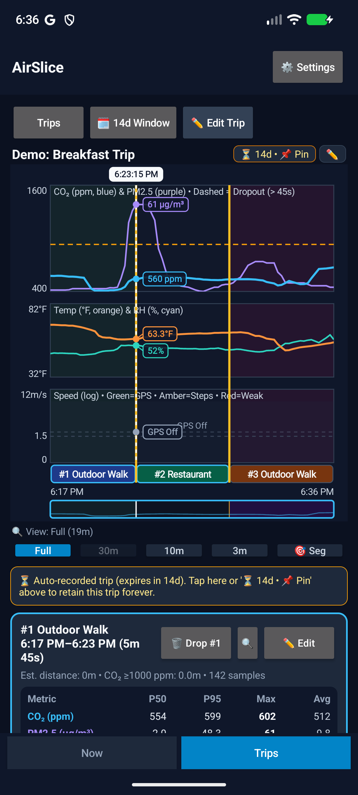
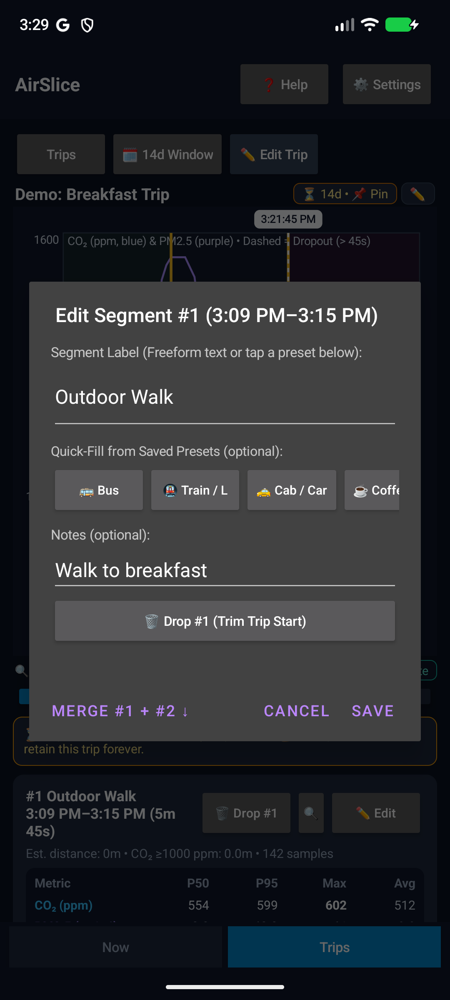
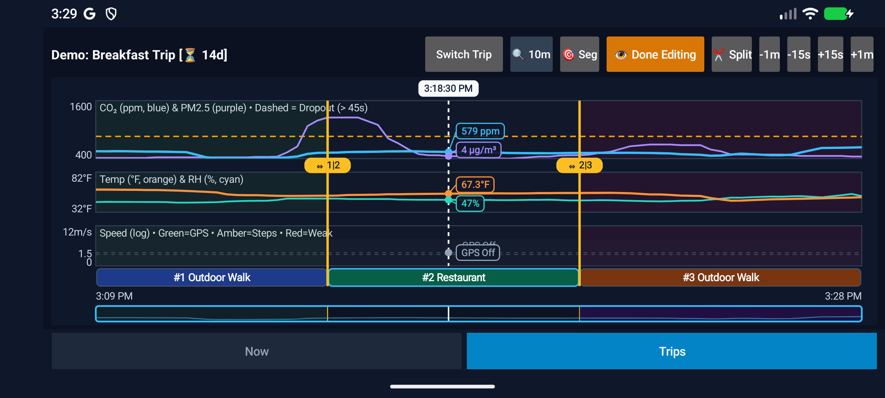

# How Trips, Segments, and Splits Work

A recorded trip in `AirSlice` starts as a single continuous timeline from when recording begins until it ends. **Slicing** lets you divide that timeline into consecutive legs—called **Segments**—so you can label places (like a bus ride vs. a coffee shop) and inspect air-quality and speed metrics for each interval on its own.

---

## 1. Segments vs. Dividers: What `#1`, `#2`, and `⇔ 1|2` Mean

* A **Segment (`#1`, `#2`, `#3`, ...)** is a **time interval**—it has a start time, an end time, a duration, and its own air-quality/mobility summary.
* A **Divider (`⇔ 1|2`, `⇔ 2|3`, ...)** is the **shared boundary timestamp** separating two neighboring segments.

```text
Trip Start (4:59 PM)    ⇔ 1|2 (5:17 PM)    ⇔ 2|3 (5:44 PM)   ⇔ 3|4 (5:59 PM)   Trip End (6:14 PM)
├───────────────────────┼──────────────────┼──────────────────┼──────────────────┤
│ #1 CTA Bus #22 (18m)  │ #2 Loop Coffee   │ #3 Bookshop      │ #4 Return Cab    │
│ 4:59 PM – 5:17 PM     │ Shop (27m)       │ (15m)            │ (15m)            │
│                       │ 5:17 PM – 5:44 PM│ 5:44 PM – 5:59 PM│ 5:59 PM – 6:14 PM│
```

* **`#1` always starts when the trip starts** and ends at the first divider (`⇔ 1|2`). Its metadata describes everything from the **start of the trip up to `⇔ 1|2`**.
* **`#2` starts where `#1` ends (`⇔ 1|2`)** and runs up to `⇔ 2|3` (or the end of the trip if there is only one split).
* Every segment card shows its exact clock span and duration right in the header (for example: `#1 CTA Bus #22` / `4:59 PM–5:17 PM (18m)`), matching its colored block in the **Segment Strip** directly below the charts.

---

## 2. View Mode: Exploring Safely

**Trips** opens in **View Mode** by default, hiding edit handles so you can scrub freely without accidentally shifting a boundary.



* **Three synchronized panes** share one horizontal timeline:
  * **Pane 1 — Air Quality:** `CO₂ (ppm, blue) & PM2.5 (purple) • Dashed = Dropout (> 45s)`
  * **Pane 2 — Thermal Comfort:** `Temp (°F, orange) & RH (%, cyan)` (or `°C`, controlled by Android locale / **⚙️ Settings**)
  * **Pane 3 — Mobility & Context:** `Speed (log) • Green=GPS • Amber=Steps • Red=Weak` (logarithmic speed scale with green GPS speed, amber step-estimated movement, red shading for weak GPS `> 50 m`, and slate `GPS Off` bands)
* **Segment Strip:** Directly under Pane 3, numbered blocks (`#1`, `#2`, `#3`, ...) show how the timeline is partitioned and alternate colors so adjacent segments are easy to distinguish.
* **Overview Minimap:** Directly below the time axis, a compact navigator bar previews the full trip's CO₂ and PM2.5 curve, yellow divider ticks, white cursor line, and the highlighted blue viewport window.
* **Scrubbing cursor & card navigation:** Drag horizontally across any pane to move the dashed vertical cursor (`6:23:15 PM`). The callout pills update across all three panes at once, and **both** the corresponding block in the Segment Strip and the matching segment card below highlight with a cyan outline. Single-tapping a segment card places the cursor inside that segment and pans the viewport to reveal it while keeping your current zoom level; tapping **`🔍`** on a card header (or double-tapping a block in the Segment Strip) zooms straight onto that segment.

---

## 3. Zooming, Panning, and Focusing Long Trips

Whether you are reviewing a 20-minute errand or a multi-hour excursion, the Trips chart provides several ways to zoom in cleanly and scrub without losing context:

* **Overview Minimap Drag & Tap:** Drag the highlighted viewport thumb left or right—or tap anywhere along the minimap bar—to jump or pan smoothly across the full trip while keeping overall air-quality peaks, yellow divider ticks, and the white cursor marker visible.
* **Quick-Zoom Presets (Portrait):** Below the chart, the status line displays **`🔍 View: Full (<duration>)`** at full scale or **`🔍 Zoom: <window> of <trip>`** while zoomed in. Tap **`Full`**, **`30m`**, **`10m`**, **`3m`**, or **`🎯 Seg`** to switch zoom windows centered on the cursor (presets wider than the current trip appear dimmed; minimum zoom window is `3m`).
* **Touch Gestures & Edge Auto-Scroll:**
  * **Two-finger pinch & pan:** Pinch horizontally inside the chart panes to zoom around the focal timestamp, or slide with two fingers to pan.
  * **Double-tap chart:** Double-tap anywhere inside the 3-pane plot area to toggle between zoomed detail and the full trip view.
  * **Edge auto-scroll:** While zoomed in, dragging the scrubbing cursor (or a `⇔` divider in Edit Mode) near the left or right edge of the chart smoothly scrolls the window along with your finger.
* **Dynamic Y-Axis Auto-Scaling:** When zoomed into a window, the vertical axes scale automatically to the visible data (while preserving standard baseline floors such as `400–1600 ppm` CO₂ and `35 µg/m³` PM2.5) so smaller peaks stand out clearly.
* **Segment & Divider Focus (`🔍` / `🎯 Seg`):** Tap **`🔍`** on any segment card header, double-tap a block in the Segment Strip, or tap **`🎯 Seg`** to frame that segment with breathing room past both boundaries (or center tightly on the active boundary when a `⇔` divider is selected in Edit Mode). Your zoom window stays preserved when rotating between Portrait and Landscape.

---

## 4. Edit Mode: Splitting, Trimming, and Adjusting Boundaries

Tap **`✏️ Edit Trip`** in the top bar (it turns orange as **`👁️ Done Editing`**) to reveal divider handles and the boundary toolbar.


* **Splitting a segment (`✂️ Split`):**
  1. Tap or drag anywhere inside a segment to place the dashed cursor where your environment changed (for example, stepping off a bus or walking into a coffee shop).
  2. Use **`-1m` / `-15s` / `+15s` / `+1m`** before selecting a divider if you want to nudge the cursor timestamp first.
  3. Tap **`✂️ Split`**. That segment is divided at the cursor timestamp into two adjacent segments without altering any earlier or later boundaries.
* **Adjusting a divider (`⇔ 1|2`, `⇔ 2|3`, ...):**
  * Each boundary pill sits along the vertical yellow line between the two segments it separates—for example, **`⇔ 1|2`** sits between **`#1` (left)** and **`#2` (right)**.
  * Tap or drag any **`⇔`** pill to select it (highlighted in orange) and slide it left or right—dragging near either chart edge while zoomed in auto-scrolls the timeline with your finger. The helper line underneath confirms which boundary is active and which two segments it separates.
  * While a divider is selected, **`-1m` / `-15s` / `+15s` / `+1m`** nudge that boundary cleanly (keeping it visible inside the viewport), and tapping **`🎯 Seg`** zooms right onto that divider for fine adjustments. Moving a divider updates the end of the left segment and the start of the right segment together, so segments never overlap or leave gaps.
* **Switching back to cursor placement (`🎯 Cursor`):**
  * While a divider is selected, tap **`🎯 Cursor`** (or tap inside the chart away from the `⇔` handle, tap the helper banner, or tap a segment card) to switch back to aiming a new split cursor without leaving Edit Mode.
* **Trimming the start or end of a trip (`🗑️ Drop #1` / `🗑️ Drop #N`):**
  * When a trip has two or more segments, tap **`🗑️ Drop #1`** on the first segment card (or **`🗑️ Drop #1 (Trim Trip Start)`** inside its **`✏️ Edit`** dialog) to drop everything before the first split, or **`🗑️ Drop #N`** on the last segment card to drop everything after the last split.
* Tap **`👁️ Done Editing`** when you are done so the timeline returns to safe View Mode.

---

## 5. Labeling, Presets, Segment Notes, Timeline Notes, and Merging

Tap **`✏️ Edit`** on any segment card to open **`Edit Segment #N (<start>–<end>)`**.



* **Segment Label:** Enter any description (for example, `CTA Bus #22`) or tap a chip under **Quick-Fill from Saved Presets** (`Bus`, `Train / L`, `Cab / Car`, etc.) to populate the label in one tap.
* **Segment Notes:** Record leg-level context such as crowding, HVAC state, or portable filtration (`"Outbound bus"`, `"Busy espresso bar"`).
* **Merging adjacent segments (`MERGE #1 + #2 ↓`):** Combines the current segment with the segment immediately following it (`#1 + #2`), removing the divider between them while preserving the earlier segment's metadata.

### Timestamped Timeline Notes & "Promote to Split"

Timeline Notes are lightweight point-in-time bookmarks you can drop at an exact moment—either live on the **Now** screen or retroactively on **Trips**—distinct from segment splits until you decide to turn one into a boundary:

* **Add Live or from the Recent History Chart on Now (`📝 Add Note`):** By default, the **Now** 15-minute chart cursor follows the **Live** right edge (`Live • h:mm:ss a`); touching or dragging left detaches it to inspect a recent reading (showing **`↩ Live`** in the header to snap back). Tapping **`📝 Add Note`** uses the chart's **Selected** timestamp when detached (with a **`📍 Selected` / `🕒 Now`** pill toggle inside the dialog in case you meant to log the current moment), or freezes the current timestamp when following Live. Tap a quick-fill chip from your Saved Presets (`Bus`, `Train / L`, `Cab / Car`, etc.) or leave blank to save `📍 Marker`. Notes can be added even when **no trip is active**—if no trip covers the chosen timestamp (or only a brief Wi-Fi debounce is pending for `Now`), the dialog warns that unpinned notes are discarded after **14 days** unless covered by a pinned trip.
* **Add Retroactively on Trips (`📝 + Note` / Landscape `📝 Note`):** Scrub the chart cursor to any timestamp and tap **`📝 + Note`** (portrait header) or **`📝 Note`** (landscape bar), or tap a teal diamond pin on the top rail / chart to jump the cursor and edit or delete the note.
* **Segment Cards & Promote to Split (`✂️ Split`):** Each timeline note appears on the chart and minimap as a teal marker and lists inside its enclosing Segment Card (tap a note row to jump the cursor there). Any note strictly inside a segment (so a 15-second-aligned split falls strictly between the segment's start and end) offers **`✂️ Split`**, letting you convert it into an editable segment boundary via two choices:
  * **`Split & Label #N+1`** *(or **`Split & Remove Marker`** for blank `📍 Marker` notes)*: Splits at the nearest 15-second grid slot, copies the note text onto the new `#N+1` segment's label, and removes the standalone note marker.
  * **`Split & Keep Note`**: Creates the split boundary while keeping the timestamped note intact.

---

## 6. Zero-Scroll Landscape View

Rotate your device to **Landscape** to view all three sensor panes, the Segment Strip, the Overview Minimap, and the compact top bar (`Switch Trip`, **`🔍 10m`** / **`🔍 3m`** / **`🔍 Full`**, **`🎯 Seg`**, **`📝 Note`** in View Mode, **`👁️ Done Editing`**, and **`✂️ Split | -1m | -15s | +15s | +1m`**) simultaneously with zero vertical scrolling. Landscape gives wider horizontal spacing, making long trips, minimap scrubbing, and fine boundary placement even easier.



---

## 7. Keeping Data Permanently, Auto-Discarded Wi-Fi Dropouts, and XLSX Export/Import

* **Trip Picker Duration & Status (`Switch Trip` / trip title):** Tap **`Trips`** / **`Switch Trip`** to browse recorded trips; each entry displays its elapsed duration (`• 42m • ⏳ 12d` counting down remaining days from `⏳ 14d` to `⏳ <1d` before ring-buffer rotation, `• Live (12m)` while ongoing, or `• 📌 Pinned` when retained permanently) so brief dropouts are immediately distinguishable from real excursions.
* **Automatic Cleanup of Momentary Auto-Trips (`< 3m`):** If home Wi-Fi drops briefly and reconnects before a real excursion begins, any **untouched, unpinned, auto-recorded trip shorter than 3 minutes** is automatically discarded ~90 seconds after closing so temporary AP glitches do not clutter your Trip list.
  * **Always kept:** Trips you **start manually** (`🚶 Start Trip Manually`), trips carved from **`🗓️ 14d Window`**, **pinned** trips, trips containing **timeline notes**, and any trip you **rename, annotate, split, or relabel** are never auto-discarded—even if shorter than 3 minutes. Unpinned standalone notes expire alongside the 14-day ring window unless covered by a pinned trip.
  * **No readings lost:** Discarding a short auto-trip entry only removes the trip wrapper; every 15-second reading remains in the 14-day circular buffer and can still be viewed or carved anytime via **`🗓️ 14d Window`**.
* **Wi-Fi Disconnect Debounce (`⚙️ Settings`):** Configure how long `AirSlice` waits after Saved Place Wi-Fi drops before creating an auto-trip and waking GPS (**`30s — Default`** to avoid waking location on short Wi-Fi dropouts, or choose **`0s` Immediate** to capture elevators and hallways right away, **`15s`**, or **`60s`**). When a delayed debounce confirms departure, the trip start timestamp is back-dated to when Wi-Fi first dropped. Manual trips always start immediately regardless of this setting, stay open across Saved Wi-Fi Place re-entry until you explicitly end them, and post a reminder notification with an **End Trip** action when you reconnect to a Saved Wi-Fi Place.
* **14-Day Ring Window (`[⏳ 14d]`):** Full 15-second sensor data automatically stays available in the local circular buffer for ~14 days. Auto-recorded trips show their remaining window (`⏳ 12d`, `⏳ <1d`) and are **not** kept beyond 14 days unless you pin the trip.
* **Pinning, Trimming & Renaming a Trip (`⏳ 14d • 📌 Pin` / `✏️`):** Tap **`⏳ 14d • 📌 Pin`** next to an auto-recorded trip's title to save the trip's 15-second readings permanently (`📌 Pinned`). Unwanted leading or trailing segments can be removed before or after pinning via **`🗑️ Drop #1`** / **`🗑️ Drop #N`** without retaining dead time. Tapping **`✏️`** (or the trip title) opens **Manage Trip**, where you can rename, export, or delete the trip and toggle **`📌 Retain / Pin Entire Trip Forever`** (editing the title of an unpinned trip also pre-selects pinning for you). If a pinned trip is already outside the 14-day ring buffer window, unpinning it warns and deletes it through the same confirmation flow as trip deletion.
* **`🗓️ 14d Window`:** Need to inspect or slice a span you forgot to record as a manual trip? Tap **`🗓️ 14d Window`** to preview a window or **Carve as New Trip** straight out of the last 14 days of background telemetry; carved trips are pinned automatically (`📌 Pinned`) so their data won't age out.
* **`📤 Export Trip (.xlsx)` (Manage Trip) & `📤 Export XLSX` (per segment):** Tap **`✏️` → `📤 Export Trip (.xlsx)`** to share a complete 4-sheet workbook (`Trip`, `Segments`, `Notes`, `Samples`) preserving all split boundaries, labels, timeline notes, and 15-second samples, or tap **`📤 Export XLSX`** on any segment card for a single-segment workbook.
* **`📥 Import Trip (.xlsx)...` (Switch Trip / Empty State):** Import any AirSlice `.xlsx` workbook back into the app with original timestamps preserved as a permanently **pinned** trip (`PINNED_SLICE_DATA`), restoring its segments and timeline notes without touching your live 14-day ring buffer. When **`🛠️ Demo Data & Replay Controls`** is enabled in Settings, **`📂 Demo Replay XLSX (Time-Shifted)...`** replays an `.xlsx` file shifted to `now`.
