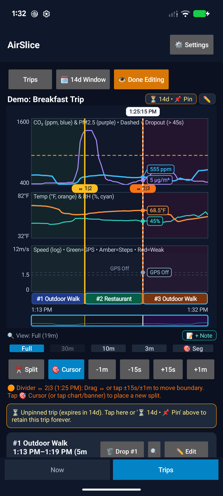

# How Trips, Segments, and Splits Work

A recorded trip in `AirSlice` starts as a single continuous timeline from when recording begins until it ends. **Slicing** lets you divide that timeline into consecutive legs—called **Segments**—so you can label places (like a bus ride vs. a coffee shop) and inspect air-quality and speed metrics for each interval on its own.

---

## 1. Segments vs. Dividers: What `#1`, `#2`, and `⇔ 1|2` Mean

* A **Segment (`#1`, `#2`, `#3`, ...)** is a **time interval**—it has a start time, an end time, a duration, and its own air-quality/mobility summary.
* A **Divider (`⇔ 1|2`, `⇔ 2|3`, ...)** is the **shared boundary timestamp** separating two neighboring segments.

```text
Trip Start (4:59 PM)     ⇔ 1|2 (5:17 PM)      ⇔ 2|3               ⇔ 3|4        Trip End (6:14 PM)
├────────────────────────┼──────────────────┼─────────────────┼───────────────────────────────┤
│  #1 CTA Bus #22 (18m)  │ #2 Loop Coffee   │ #3 Bookshop    │  #4 Return Cab                │
│  3:54 PM – 4:12 PM     │ Shop (27m)       │ (15m)          │  (15m)                        │
│                        │ 4:12 PM – 4:39 PM│                │                               │
```

* **`#1` always starts when the trip starts** and ends at the first divider (`⇔ 1|2`). Its metadata describes everything from the **start of the trip up to `⇔ 1|2`**.
* **`#2` starts where `#1` ends (`⇔ 1|2`)** and runs up to `⇔ 2|3` (or the end of the trip if there is only one split).
* Every segment card shows its exact clock span and duration right in the header (for example: `#1 CTA Bus #22` / `4:59 PM–5:17 PM (18m)`), matching its colored block in the **Segment Strip** directly below the charts.

---

## 2. View Mode: Exploring Safely

**Trips** opens in **View Mode** by default, hiding edit handles so you can scrub freely without accidentally shifting a boundary.


* **Three synchronized panes** share one horizontal timeline:
  * **Pane 1 — Air Quality:** `CO₂ (ppm, blue) & PM2.5 (purple) • Dashed = Dropout (> 45s)`
  * **Pane 2 — Thermal Comfort:** `Temp (°F, orange) & RH (%, cyan)` (or `°C`, controlled by Android locale / **⚙️ Settings**)
  * **Pane 3 — Mobility & Context:** `Speed (green) • Slate = GPS Off • Red = Weak GPS`
* **Segment Strip:** Directly under Pane 3, numbered blocks (`#1`, `#2`, `#3`, ...) show how the timeline is partitioned and alternate colors so adjacent segments are easy to distinguish.
* **Scrubbing cursor:** Drag horizontally across any pane to move the dashed vertical cursor (`5:21:45 PM`). The callout pills update across all three panes at once, and **both** the corresponding block in the Segment Strip and the matching segment card below highlight with a cyan outline.

---

## 3. Edit Mode: Splitting, Trimming, and Adjusting Boundaries

Tap **`✏️ Edit Trip`** in the top bar (it turns orange as **`👁️ Done Editing`**) to reveal divider handles and the boundary toolbar.



* **Splitting a segment (`✂️ Split`):**
  1. Tap or drag anywhere inside a segment to place the dashed cursor where your environment changed (for example, stepping off a bus or walking into a coffee shop).
  2. Use **`-1m` / `-15s` / `+15s` / `+1m`** before selecting a divider if you want to nudge the cursor timestamp first.
  3. Tap **`✂️ Split`**. That segment is divided at the cursor timestamp into two adjacent segments without altering any earlier or later boundaries.
* **Adjusting a divider (`⇔ 1|2`, `⇔ 2|3`, ...):**
  * Each boundary pill sits along the vertical yellow line between the two segments it separates—for example, **`⇔ 1|2`** sits between **`#1` (left)** and **`#2` (right)**.
  * Tap or drag any **`⇔`** pill to select it (highlighted in orange) and slide it left or right. The helper line underneath confirms which boundary is active and which two segments it separates.
  * While a divider is selected, **`-1m` / `-15s` / `+15s` / `+1m`** nudge that boundary cleanly. Moving a divider updates the end of the left segment and the start of the right segment together, so segments never overlap or leave gaps.
* **Switching back to cursor placement (`🎯 Cursor`):**
  * While a divider is selected, tap **`🎯 Cursor`** (or tap inside the chart away from the `⇔` handle, tap the helper banner, or tap a segment card) to switch back to aiming a new split cursor without leaving Edit Mode.
* **Trimming the start or end of a trip (`🗑️ Drop #1` / `🗑️ Drop #N`):**
  * When a trip has two or more segments, tap **`🗑️ Drop #1`** on the first segment card (or **`🗑️ Drop #1 (Trim Trip Start)`** inside its **`✏️ Edit`** dialog) to drop everything before the first split, or **`🗑️ Drop #N`** on the last segment card to drop everything after the last split.
* Tap **`👁️ Done Editing`** when you are done so the timeline returns to safe View Mode.

---

## 4. Labeling, Presets, Notes, and Merging

Tap **`✏️ Edit`** on any segment card to open **`Edit Segment #N (<start>–<end>)`**.


* **Segment Label:** Enter any description (for example, `CTA Bus #22`) or tap a chip under **Quick-Fill from Saved Presets** (`Bus`, `Train / L`, `Cab / Car`, etc.) to populate the label in one tap.
* **Notes:** Record extra context such as crowding, HVAC state, or portable filtration (`"Outbound bus"`, `"Busy espresso bar"`).
* **Merging adjacent segments (`MERGE #1 + #2 ↓`):** Combines the current segment with the segment immediately following it (`#1 + #2`), removing the divider between them while preserving the earlier segment's metadata.

---

## 5. Zero-Scroll Landscape View

Rotate your device to **Landscape** to view all three sensor panes, the Segment Strip, and the full Edit Mode bar (`Switch Trip`, `👁️ Done Editing`, `✂️ Split | -1m | -15s | +15s | +1m`) simultaneously with zero vertical scrolling. Landscape gives wider horizontal spacing, making long trips and fine boundary placement even easier.


---

## 6. Keeping Data Permanently, Custom 14-Day Windows, and CSV Export

* **14-Day Ring Window (`[14d]`):** Full 15-second sensor data automatically stays available in the local circular buffer for ~14 days. Auto-recorded trips are **not** kept beyond 14 days unless you pin the trip.
* **Pinning, Trimming & Renaming a Trip (`⏳ 14d • 📌 Pin` / `✏️`):** Tap **`⏳ 14d • 📌 Pin`** next to an auto-recorded trip's title to save the trip's 15-second readings permanently (`📌 Pinned`). Unwanted leading or trailing segments can be removed before or after pinning via **`🗑️ Drop #1`** / **`🗑️ Drop #N`** without retaining dead time. Tapping **`✏️`** (or the trip title) opens **Manage Trip**, where you can rename or delete the trip and toggle **`📌 Retain / Pin Entire Trip Forever`** (editing the title of an unpinned trip also pre-selects pinning for you). If a pinned trip is already outside the 14-day ring buffer window, unpinning it warns and deletes it through the same confirmation flow as trip deletion.
* **`🗓️ 14d Window`:** Need to inspect or slice a span you forgot to record as a manual trip? Tap **`🗓️ 14d Window`** to preview a window or **Carve as New Trip** straight out of the last 14 days of background telemetry; carved trips are pinned automatically (`📌 Pinned`) so their data won't age out.
* **`📤 Export CSV` (per segment):** Tap **`📤 Export CSV`** on any segment card to export every 15-second sample slot inside that segment (in chronological order, along with its trip/segment metadata and telemetry columns) and share it as an attached `.csv` file for email, messaging, or downstream charting/reporting tools.
