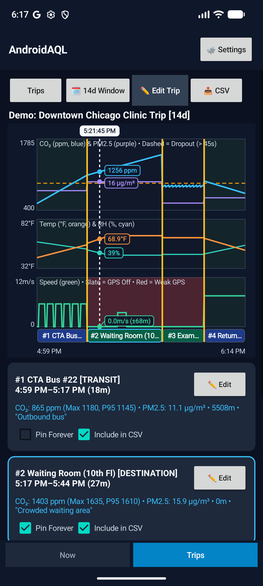
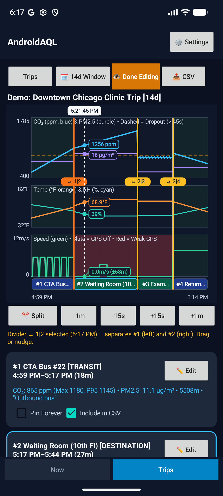
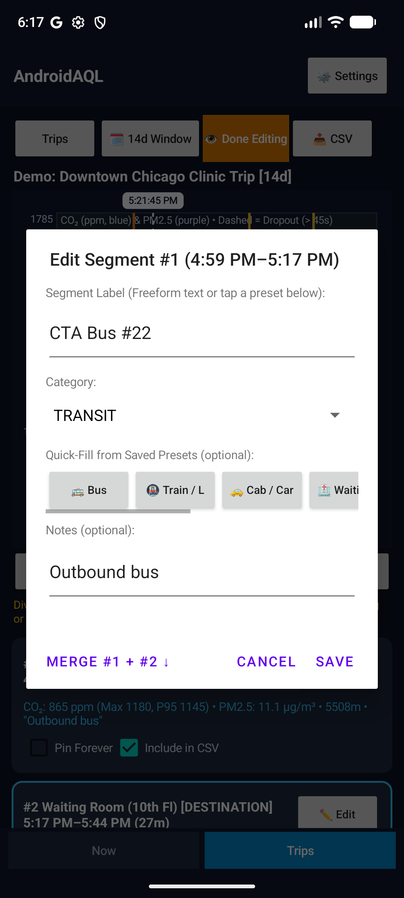
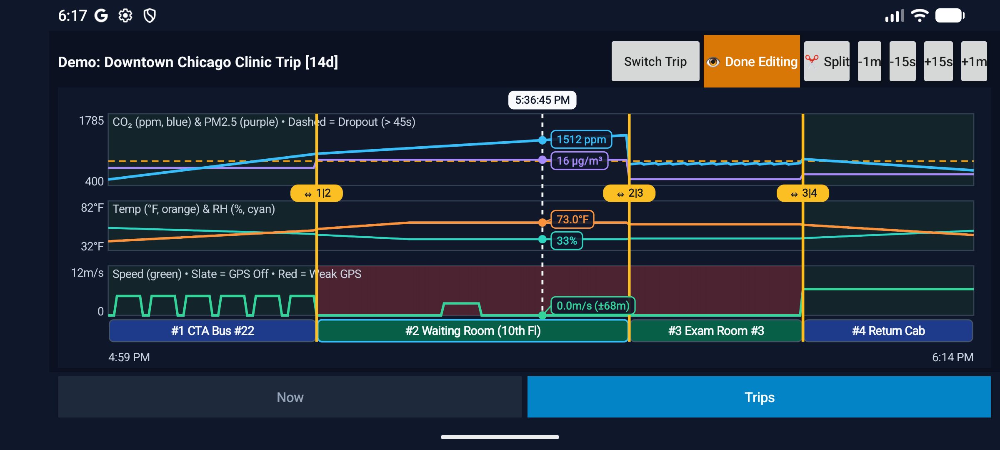

# How Trips, Segments, and Splits Work

A recorded trip in `AndroidAQL` starts as a single continuous timeline from when recording begins until it ends. **Slicing** lets you divide that timeline into consecutive legs—called **Segments**—so you can label places (like a bus ride vs. a waiting room) and inspect air-quality and speed metrics for each interval on its own.

---

## 1. Segments vs. Dividers: What `#1`, `#2`, and `⇔ 1|2` Mean

* A **Segment (`#1`, `#2`, `#3`, ...)** is a **time interval**—it has a start time, an end time, a duration, and its own air-quality/mobility summary.
* A **Divider (`⇔ 1|2`, `⇔ 2|3`, ...)** is the **shared boundary timestamp** separating two neighboring segments.

```text
Trip Start (4:59 PM)     ⇔ 1|2 (5:17 PM)      ⇔ 2|3               ⇔ 3|4        Trip End (6:14 PM)
├────────────────────────┼──────────────────┼─────────────────┼───────────────────────────────┤
│  #1 CTA Bus #22 (18m)  │ #2 Waiting Room  │ #3 Exam Room #3 │  #4 Return Cab                │
│  4:59 PM – 5:17 PM     │ (10th Fl) (27m)  │                 │                               │
│                        │ 5:17 PM – 5:44 PM│                 │                               │
```

* **`#1` always starts when the trip starts** and ends at the first divider (`⇔ 1|2`). Its metadata describes everything from the **start of the trip up to `⇔ 1|2`**.
* **`#2` starts where `#1` ends (`⇔ 1|2`)** and runs up to `⇔ 2|3` (or the end of the trip if there is only one split).
* Every segment card shows its exact clock span and duration right in the header (for example: `#1 CTA Bus #22 [TRANSIT]` / `4:59 PM–5:17 PM (18m)`), matching its colored block in the **Segment Strip** directly below the charts.

---

## 2. View Mode: Exploring Safely

**Trips** opens in **View Mode** by default, hiding edit handles so you can scrub freely without accidentally shifting a boundary.



* **Three synchronized panes** share one horizontal timeline:
  * **Pane 1 — Air Quality:** `CO₂ (ppm, blue) & PM2.5 (purple) • Dashed = Dropout (> 45s)`
  * **Pane 2 — Thermal Comfort:** `Temp (°F, orange) & RH (%, cyan)` (or `°C`, controlled by Android locale / **⚙️ Settings**)
  * **Pane 3 — Mobility & Context:** `Speed (green) • Slate = GPS Off • Red = Weak GPS`
* **Segment Strip:** Directly under Pane 3, numbered blocks (`#1`, `#2`, `#3`, ...) show how the timeline is partitioned and match the colors of their segment categories.
* **Scrubbing cursor:** Drag horizontally across any pane to move the dashed vertical cursor (`5:21:45 PM`). The callout pills update across all three panes at once, and **both** the corresponding block in the Segment Strip and the matching segment card below highlight with a cyan outline.

---

## 3. Edit Mode: Splitting and Adjusting Boundaries

Tap **`✏️ Edit Trip`** in the top bar (it turns orange as **`👁️ Done Editing`**) to reveal divider handles and the boundary toolbar.



* **Splitting a segment (`✂️ Split`):**
  1. Tap or drag anywhere inside a segment to place the white dashed cursor where your environment changed (for example, stepping off a bus or walking into a clinic room).
  2. Use **`-1m` / `-15s` / `+15s` / `+1m`** before selecting a divider if you want to nudge the cursor timestamp first.
  3. Tap **`✂️ Split`**. That segment is divided at the cursor timestamp into two adjacent segments without altering any earlier or later boundaries.
* **Adjusting a divider (`⇔ 1|2`, `⇔ 2|3`, ...):**
  * Each boundary pill sits along the vertical yellow line between the two segments it separates—for example, **`⇔ 1|2`** sits between **`#1` (left)** and **`#2` (right)**.
  * Tap or drag any **`⇔`** pill to select it (highlighted in orange) and slide it left or right. The helper line underneath confirms which boundary is active and which two segments it separates.
  * While a divider is selected, **`-1m` / `-15s` / `+15s` / `+1m`** nudge that boundary cleanly. Moving a divider updates the end of the left segment and the start of the right segment together, so segments never overlap or leave gaps.
* Tap **`👁️ Done Editing`** when you are done so the timeline returns to safe View Mode.

---

## 4. Labeling, Presets, Notes, and Merging

Tap **`✏️ Edit`** on any segment card to open **`Edit Segment #N (<start>–<end>)`**.



* **Segment Label:** Enter any description (for example, `CTA Bus #22`) or tap a chip under **Quick-Fill from Saved Presets** (`Bus`, `Train / L`, `Cab / Car`, etc.) to populate both label and category in one tap.
* **Category:** Assign the segment's category (such as `TRANSIT` or `DESTINATION`), which sets its color in the Segment Strip and annotates exports.
* **Notes:** Record extra context such as crowding, HVAC state, or portable filtration (`"Outbound bus"`, `"Crowded waiting area"`).
* **Merging adjacent segments (`MERGE #1 + #2 ↓`):** Combines the current segment with the segment immediately following it (`#1 + #2`), removing the divider between them while preserving the earlier segment's metadata.

---

## 5. Zero-Scroll Landscape View

Rotate your device to **Landscape** to view all three sensor panes, the Segment Strip, and the full Edit Mode bar (`Switch Trip`, `👁️ Done Editing`, `✂️ Split | -1m | -15s | +15s | +1m`) simultaneously with zero vertical scrolling. Landscape gives wider horizontal spacing, making long trips and fine boundary placement even easier.



---

## 6. Keeping Data Permanently, Custom 14-Day Windows, and CSV Export

* **14-Day Ring Window (`[14d]`):** Full 15-second sensor data automatically stays available in the local circular buffer for ~14 days.
* **`Pin Forever` (per segment):** Check **`Pin Forever`** on any segment card to copy that interval's 15-second readings into permanent storage so they are preserved even after the 14-day buffer rotates past that day. You can pin only the interesting exposure windows (such as a specific flight or waiting room) without keeping dead time.
* **`🗓️ 14d Window`:** Need to inspect or slice a span you forgot to record as a manual trip? Tap **`🗓️ 14d Window`** to carve a custom start/end window straight out of the last 14 days of background telemetry.
* **`Include in CSV` & `📤 CSV`:** Check or uncheck **`Include in CSV`** on each segment card, then tap **`📤 CSV`** to export the selected segments and their labels/telemetry.
